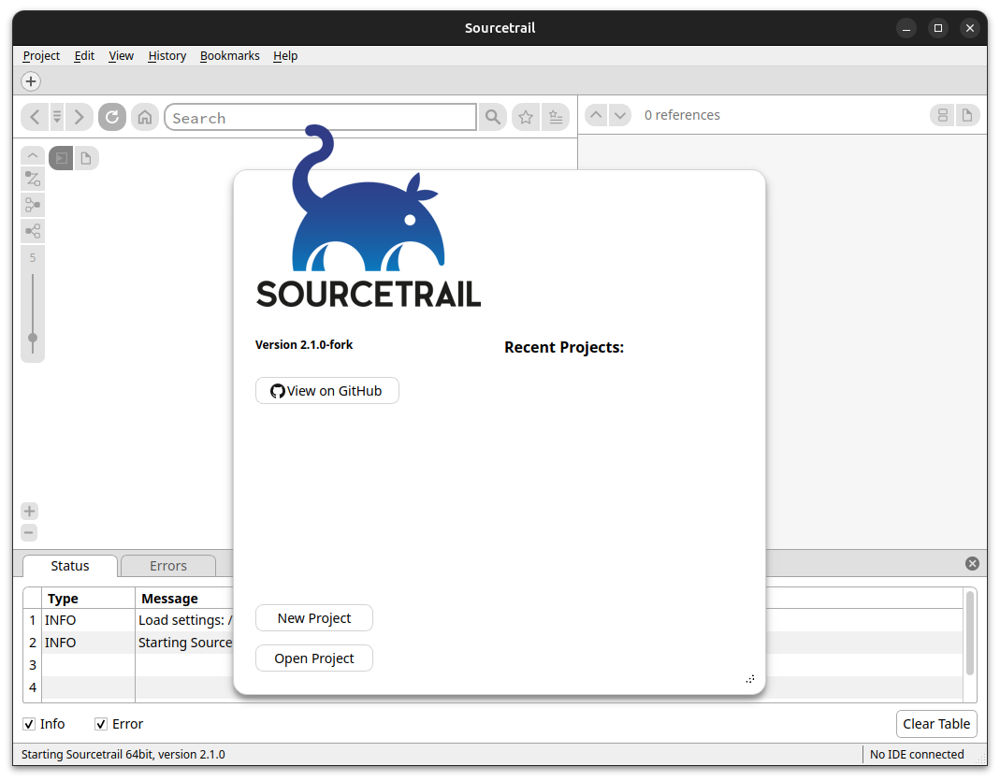
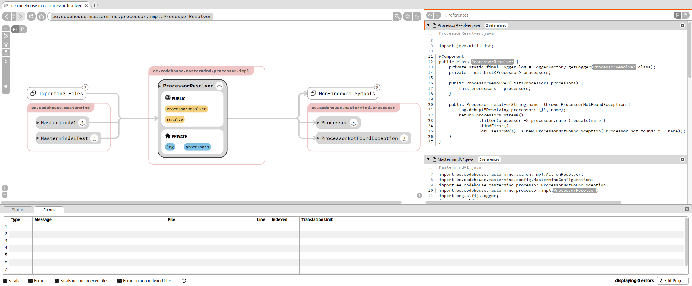
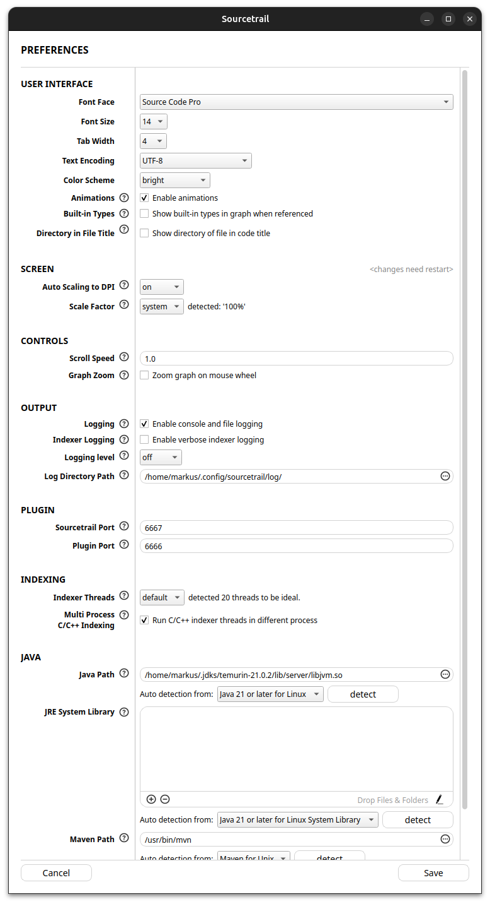

Documentation for version 2.1.0-fork

# Welcome

This document explains how to work with this fork of Sourcetrail, which builds for Linux x86-64.

## Overview

Sourcetrail is an interactive source explorer that simplifies navigation in existing source code by indexing your code and gathering data about its structure. Sourcetrail then provides a simple interface consisting of three interactive views, each playing a key role in helping you obtain the information you need:


* **Search:** Use the search field to quickly find and select indexed symbols in your source code. The autocompletion box will instantly provide an overview of all matching results throughout your codebase.
* **Graph:** The graph displays the structure of your source code. It focuses on the currently selected symbol and directly shows all incoming and outgoing dependencies to other symbols.
* **Code:** The Code view displays all source locations of the currently selected symbol in a list of code snippets. Clicking on a different source location allows you to change the selection and dig deeper.

Note: this fork supports Java, TypeScript and Python. C/C++ is work in progress. For more information have a look at [supported languages](#supported-languages).

## Supported Languages

### Java

Sourcetrail indexes Java up to Java 25, powered by [Eclipse JDT](https://github.com/eclipse/eclipse.jdt.core). Preview features are not enabled. Indexing needs JDK 21 or newer, also for Java 22–25 code. Java records are [not indexed yet](#st-known-limits). If you encounter any issues while using Sourcetrail on a Java project, please provide a minimal example in the [issue tracker](https://github.com/Shmarkus/Sourcetrail/issues).

### TypeScript

Sourcetrail indexes TypeScript projects that have a `tsconfig.json`, powered by [scip-typescript](https://github.com/sourcegraph/scip-typescript). Indexing needs Node.js 22.13 or newer and the project's `node_modules` (run `npm install` first). In an Angular + Spring application kept in one folder, each frontend HTTP call is linked to the Spring handler it reaches, so call graphs run from the frontend into the backend and back. Angular HTML templates, JavaScript-only projects and frontends in a different folder than their backend are not covered. See [TypeScript and the frontend–backend link](#typescript-and-the-frontendbackend-link) for details.

### C and C++

Work in progress: C and C++ indexing is not in this fork's current builds.

### Python

Sourcetrail indexes Python projects, powered by [scip-python](https://github.com/sourcegraph/scip-python). Indexing needs Node.js 22.13 or newer. Calls into libraries resolve when the project has a Python environment with its dependencies installed: a `.venv` or `venv` in the project folder, the active virtualenv, or any interpreter named in the project settings; without one the project's own code still indexes. Test files are indexed like any other code. See [Python projects](#python-projects) for details.


# Getting Started

This short introduction will briefly guide you through the project setup and the user interface of Sourcetrail. The bullet point lists will provide you with the next steps to take:

## Starting Up Sourcetrail

Once you've [downloaded](https://github.com/Shmarkus/Sourcetrail/releases) Sourcetrail successfully you are ready to run the application. For assistance with installation, visit the [installation](#installation) section.

> **Tasks:**
> * Launch Sourcetrail.

After launching Sourcetrail you will see the [Start Window](#start-window). From here you can create your own project or open an existing one.

> **Tasks:**
> * Click **New Project** to create a new project.
> * or select one from the **Recent Projects** and continue with the [User Interface](#user-interface)



## Creating a New Project

**New Project** asks for your project's source folder in the standard folder picker. There is no setup wizard: Sourcetrail looks at the top level of the folder and sets the project up from what it finds.

* A folder that already holds a project opens that project.
* A Gradle or Maven build creates a Java project with tests included. See [New Java projects](#new-java-projects).
* A `tsconfig.json` adds TypeScript, or creates a TypeScript-only project if there is no Java build. See [TypeScript and the frontend–backend link](#typescript-and-the-frontendbackend-link).
* A `pyproject.toml`, `setup.py`, `setup.cfg` or `requirements*.txt` adds Python, as do `.py` files in a folder with no other build. See [Python projects](#python-projects).
* With none of these, Sourcetrail offers a plain Java project and opens the project settings so that you can fill in the class path.

For Custom Command source groups, manual Java source groups or several groups in one project, use **Project > New Custom Project...**, which opens the [Project Setup Wizard](#project-setup).

> **Tasks:**
> * Click **New Project** and choose your project's source folder.

## Source Indexing

After the project is created, Sourcetrail will ask you whether you want to start indexing. Click **Start** and wait for the indexing to complete. This may take a bit of time. The [Indexing Dialog](#indexing-dialogs) and the [Status Bar](#status-bar) will give you information about the progress. Otherwise the UI will be empty. Sourcetrail indexes all named symbols and their relationships throughout the provided source files.

> **Tasks:**
> * Click **Start** when asked whether to start indexing.
> * Wait until the indexing of your source files has finished.
> * or Click **Stop** or press ESC to stop indexing (Sourcetrail will provide all information gathered so far and the indexing can be continued later by [refreshing](#refresh)).


After indexing is completed, Sourcetrail will show an overview of all indexed symbols in the [graph view](#graph-view) and some statistics in the [code view](#code-view).

#### Troubleshooting Errors

If the indexing yields errors, the status view will be shown with a list of errors. You can click on the errors label on the right side of the status bar or on one of the errors in the table to see their location.

> **Tasks:**
> * Fix your errors and [refresh](#refresh) to re-index the files with errors (As long as there was no change in the specific file, Sourcetrail won't reindex it; use the **Full Refresh** option from the [Edit Menu](#edit)).
> * or ignore them and continue with an incomplete index.


## User Interface

As mentioned earlier, Sourcetrail's user interface is split into three main views. Their arrangement can be adjusted as preferred and can also be detached from the main window and split into different screens (see [Window Widgets](#subwindows)).

All three views display information about the currently selected symbol:



### 1. Search Field

The [Search Field](#search-bar) allows for easy access to all indexed symbols. Use it to find all classes and functions you wish to investigate. In addition, it also holds the UI buttons for navigating [back & forward](#back-forward-and-history) as well as [refreshing](#refresh).


When entering a search query, the [autocompletion popup](#autocompletion-popup) will provide you with a concise list of all matching symbols. Note that Sourcetrail uses a fuzzy matching algorithm, that allows you to skip characters while entering a query.


### 2. Graph Visualization

The [graph visualization](#graph-view) displays the currently selected symbol in an active state and all the other symbols it shares a relationship with. The visualization is made up of nodes and edges.

* **Nodes:** All named symbols in your source code will be displayed as different [nodes](#nodes), such as `functions`, `classes` or `files`. Nodes with members (like `classes`) can be expanded to show all their contents, the number at the expansion arrow shows how many members are hidden. Clicking a node will activate it and update all the views to the new selection. Dragging a node can be used to change its position.
* **Edges:** The relationships between the symbols are displayed as different [edges](#edges), such as `type use`, `function call` or `file include`. Sometimes edges get bundled together and are displayed as `bundled edges` that show a number of how many edges are contained. Clicking an edge will highlight its source location in the code view.


#### Colors:
The different node and edge types are also displayed using different colors. The default color scheme uses this convention:

| Color | Node | Edge
| --- | --- | ---
| gray | types and classes | type use
| yellow | functions and methods | calls
| blue | variables and fields | variable access

#### Hatching:
Nodes displayed with a striped hatching, are nodes that were used within your indexed source files, but were not defined. Clicking them shows all locations where they are used, without providing their declaration.


#### Legend:

For a full list on all existing nodes and edges take a look at the integrated [Graph Legend](#graph-legend) by clicking the `?`-button in the bottom right corner of the [Graph View](#graph-view).

### 3. Code View

The [code view](#code-view) displays all locations of the currently active symbol within the indexed source files. It does not allow for editing the source code. Syntax highlighting is used to increase readability. Source locations that are surrounded by a box when hovered can be clicked to activate the respective symbol. Active source locations are highlighted.


The source locations are displayed as code snippets, containing the line of interest and extra lines added to the top and bottom to give information about its context. Code snippets are then bundled together into files.

**Note:** A file can be selected as active symbol by clicking its name in the title bar. By clicking the title bar or the icon on the right hand side of the title bar, the file can switch between 3 different states:

* **Minimized:** The file does not show any content


* **Snippets:** The file displays the snippets containing active locations separated by lines.


* **Maximized:** The [code view](#code-view) switches to [single file mode](#single-file-mode) and the whole content of the file is visible.


For more information, please visit the [Code View Files](#files) section.

## Start Exploring!

At this point, you should have an understanding of the basics of Sourcetrail's user interface and can begin exploring your codebase. Sourcetrail will allow you to see your source code from a whole new perspective, by giving you a concise overview of its parts and a faster way of drilling down to its internals, while always maintaining the connection to the implementation details of the actual source code.

Please take look at the much more extensive instruction manual below for detailed information.

The Sourcetrail team wishes you a good start with our product, lots of saved time, increased productivity and much cleaner code.

> **Tasks:**
> * Start exploring and have fun!


# Installation

This fork ships one package, for Linux x86-64: `Sourcetrail_Linux_64bit.tar.gz` on the [releases page](https://github.com/Shmarkus/Sourcetrail/releases). Download and extract it. To start Sourcetrail run the `Sourcetrail.sh` script. Sourcetrail creates a folder `~/.config/sourcetrail` at the first run, this is the folder for Sourcetrail settings.

## Install

To install Sourcetrail run the `install.sh` script with `sudo`. It will install Sourcetrail to `/opt/sourcetrail` and create the `/usr/bin/sourcetrail` and `/usr/bin/st` symlinks.

## Uninstall

To uninstall Sourcetrail run the `/opt/sourcetrail/uninstall.sh` script with `sudo`.

## Data folder

The data folder holds certain files that are used by Sourcetrail to run the program. It is located at `~/.config/sourcetrail`.

## Finding System Header Locations

> **Work in progress:** C/C++ indexing is not in this fork's current builds.

Run either of these commands:
`gcc -x c++ -v -E /dev/null`
or
`clang -x c++ -v -E /dev/null`
You will find the header search paths your compiler uses in the output between these two lines:

```
#include <...> search starts here:
.
.
.
End of search list.
```


## Finding Java Runtime Library Location

Indexing Java projects requires JDK 21 or newer. The Java Runtime Library (called `libjvm.so`) can be found inside of your JDK install folder and looks like this:
`<jdk_path>/lib/server/libjvm.so`


# Interface

## Main Window

### Subwindows

Sourcetrail's three views are organized into subwindows, which can be freely arranged within the Main Window or detached from it. Each subwindow has a title bar displaying its name and 2 buttons for closing the subwindow and for detaching it from the Main Window.


**Interactions:**

* Drag the subwindow at the title bar to rearrange it within the Main Window, detach it or attach it again.
* Press the "x" icon to close the subwindow. They can be reopened from the [View Menu](#view).
* Press the "□" icon to detach the subwindow from the Main Window.

### Tab Bar

The Tab Bar is located at the top of the [Main Window](#main-window) and is used to open multiple symbols in parallel.


**Interactions:**

* Click on the `+` icon to open a new tab or use the [New Tab Shortcut](#shortcuts).
* Click on a tab to activate it and show it's content or use the [Next/Previous Tab Shortcuts](#shortcuts).
* Click on the `x` icon on the right of each tab to close it or use the [Close Tab Shortcut](#shortcuts).
* Click and drag a tab to change it's position.

### Status Bar

The Status Bar is located on the bottom of the [Main Window](#main-window) and is used to convey information about Sourcetrail's status and currently running processes to the user

It displays:

* The most recent status message.
* The current status of the [Code Editor Plugin](#code-editor-plugins) connection
* Error Count if the currently loaded project has errors.
* Indexing progress bar while indexing.


**Interactions:**

* Click on the status message count to display the (Status Tab](#status-tab).
* Click on the error count to display the error locations in the [Code View](#code-view).
* Click on the indexing progress bar to display the [Indexing Dialogs](#indexing-dialogs) if they were hidden.

### On-Screen Search Bar

The On-Screen Search Bar is used to search visible contents of the [Graph View](#graph-view) and [Code View](#code-view). It gets displayed at the bottom of the [Main Window](#main-window) when using the [Find On-Screen](#shortcuts) action.


**Interactions:**

* Enter a search query to search in contents of the [Graph View](#graph-view) and [Code View](#code-view).
* Click the arrow buttons next to the search field to iterate the matched locations.
* Use the checkboxes right of the search field to define which view contents will be matched.
* Click the `x` icon on the right to close the On-Screen Search Bar or press `ESC`.

## Windows

### Start Window

On every start of Sourcetrail you are shown the start window. It allows for creating new projects or opening existing ones.


**Interactions:**

* Clicking `New Project` will ask for your project's source folder (see [Creating a New Project](#creating-a-new-project)).
* Clicking `Open Project` will let you open an existing Sourcetrail project by choosing from a file dialog.
* Clicking on one of the `Recent Projects` will open this project. The list shows a maximum of 7 items ordered by recent first.
* Pressing `ESC` will close the window.
* Clicking `View on GitHub` will open the project's GitHub page in your web browser.


### Path List Box

The Path List Box is a user interface element that is used within the [Preferences Window](#preferences-window) and the [Project Setup Wizard](#project-setup-wizard). It allows for entering a list of file and directory paths.
If you want to use environment variables you can use either of the following notations.
`${VARIABLE_NAME}` or `%VARIABLE_NAME%`


**Interactions:**

* Click the "+" icon to add a new path line.
* Click the "-" icon to remove a selected path line.
* Click a path line to select it.
* Enter the path by typing on your keyboard
* Click "..." within the path line to open a file dialog for choosing a file or directory path.
* Directly add multiple paths into the box by dropping elements from your filesystem.
* Click the pen icon in the bottom right corner to edit the list as plain text.

#### Plain Text Editing

By pressing the pen icon in the bottom right corner you can open the plain text edition dialog. It allows you to edit the whole list within a text field. Each line will be one list item.


**Interactions:**

* Add and remove list items through keyboard interaction.
* Click `Cancel` to cancel plain text editing.
* Click `Save` to save your changes to the list.

### Preferences Window

The Preferences window lets you define settings for all projects. You can open the Preferences from the menu via [Edit/Preferences](#edit).



| Setting | Description
| --- | ---
| Font Face | Define the font face used throughout the UI
| Font Size | Set the font size used throughout the UI. It can also be changed with the actions in the [View Menu](#view)
| Tab Width | Define the space width of tabs in the code view.
| Text Encoding | Define the Text Encoding used for displaying your source code.
| Color scheme | Choose which color scheme Sourcetrail should display. The color schemes are located in [data](#data-folder)/color_schemes/
| Animations | Define if animations are used within the user interface.
| Built-In Types | Define whether built-in types such as int or bool are shown when referenced in the graph view.
| Directory in File Title | Enable display of the parent directory of a code file relative to the project file.
| Auto Scaling to DPI | Define if automatic scaling to screen DPI resolution is active. This setting manipulates the environment flag `QT_AUTO_SCREEN_SCALE_FACTOR` of the Qt framework. Choose 'system' to stick to the setting of your current environment.
| Scale Factor | Define a screen scale factor for the user interface of the application. This setting manipulates the environment flag `QT_SCALE_FACTOR` of the Qt framework. Choose 'system' to stick to the setting of your current environment.
| Scroll Speed | Define a multiplyer for the default scroll speed. Values smaller than 1 slow down scrolling while values greater than 1 increase the scroll speed.
| Graph Zoom | Switch the default mouse wheel behavior in the graph between scrolling and zooming.
| Logging | Ticking this box enables logging to console and to a log file. This option is disabled by default to speed up Sourcetrail. If you encounter problems while running Sourcetrail, we recommend to enable this option so you have somewhere to start looking for a cause.
| Indexer Logging | When enabled Sourcetrail will log detailed information during indexing. This log data can help us fix issues.
| Logging level | Set how much detail is logged.
| Log Directory Path | The folder that log files are saved to.
| Sourcetrail Port | Port number that Sourcetrail uses to listen for incoming messages from plugins.
| Plugin Port | Port number that Sourcetrail sends outgoing messages to.
| Indexer threads | Define how many parallel threads are used during indexing. Setting this value to `default` will cause Sourcetrail to detect the ideal number of threads based on the CPU and use as many threads for indexing.
| Multi Process C/C++ Indexing | Work in progress, with C/C++ indexing. Enable C/C++ indexer threads to run in a different process. This prevents the application from crashing due to unforeseen exceptions while indexing.
| Java Path | If you want to use Sourcetrail on Java source code, please specify the path to the `libjvm.so` of a JDK 21 or newer. You can either use the button below for automatic detection or add the path manually. For instructions on how to find it see [Finding Java Runtime Library Location](#finding-java-runtime-library-location).
| JRE System Library | Add the jar files of your JRE System Library. These jars can be found inside your JRE install directory. You can either use the button below for automatic detection or add the paths manually.
| Maven Path | Only required for indexing projects using Maven. Provide the location of your installed Maven executable. You can also use the auto detection.

### Project Setup Wizard
The Project Setup Wizard opens from **Project > New Custom Project...** and **Edit Project**. It allows for defining name and location of your Sourcetrail project and adding several **Source Groups**, that define which source files will be indexed. There are several ways to create Source Groups. It is sufficient to add only one Source Group for most projects.

For detailed information continue at [PROJECT SETUP](#project-setup).


### Indexing Dialogs

These dialogs will be used while Sourcetrail indexes your project. The whole user interface will be frozen as long as these dialogs are visible.

#### Start Indexing Dialog

This dialog displays the number of files for indexing and clearing before indexing starts. There are different refresh modes:


* **Updated files:** Reindexes all files that were modified since the last indexing, all files depending on those and new files.
* **Incomplete & updated files:** Reindexes all files that had errors during last indexing, all files depending on those and all updated files.
* **All files:** Deletes the previous index and reindexes all files.


**Interactions:**

* Switch indexing mode by clicking a different option.
* Clicking `Cancel` will abort indexing.
* Clicking `Start` will start the file clearing and indexing.

#### Progress Dialog

This dialog shows that Sourcetrail is currently doing processing that can't be interrupted.


**Interactions:**

* Clicking `Hide` will hide the dialog. You can display it again by clicking on the indexing progress bar in the [status bar](#status-bar) or [refreshing](#refresh).

#### Indexing Dialogs

This dialog shows the indexing progress of your project, by displaying the number of already indexed files, the last file that was started indexing, the number of errors and a progress estimate in percent.


**Interactions:**

* Clicking `Stop` or pressing ESC will interrupt indexing. Sourcetrail will still wait for the already running indexer threads to finish. You can continue indexing later by [refreshing](#refresh).
* Clicking `Hide` will hide the dialog. You can display it again by clicking on the indexing progress bar in the [status bar](#status-bar) or [refreshing](#refresh).

#### Finished Indexing Dialog

This dialog is shown after indexing finished, giving you information about indexed files, duration and errors.


#### Interrupted Indexing Dialog

This dialog is shown after indexing was stopped, giving you information about indexed files, duration and errors. You can choose to either use the new index or continue using the old one.


**Interactions:**

* Clicking `Discard` will discard the new index.
* Clicking `Keep` will switch your project to the new index and discard the old one.

## Menu

### Project

* **New Project**
    * Shortcut: [New Project](#shortcuts)
    * Asks for your project's source folder, then creates and loads the project (see [Creating a New Project](#creating-a-new-project)).
* **New Custom Project**
    * Opens the [Project Setup Wizard](#project-setup-wizard) to define a project by hand and loads it after creation.
* **Open Project**
    * Shortcut: [Open Project](#shortcuts)
    * Opens a file dialog to choose an existing Sourcetrail project file from your system's hard drive.
* **Recent Projects**
    * Opens a submenu to choose recent opened Sourcetrail projects.
* **Edit Project**
    * Opens the [Edit Project Dialog](#project-setup-wizard) prefilled with your project settings and allows for changing them.
* **Close Project**
    * Closes the current project.
* **Exit**
    * Quits Sourcetrail.

### Edit

* **Refresh**
    * Shortcut: [Refresh](#shortcuts)
    * Refresh will check all indexed source files for updates and reindex the ones that changed and their depending ones.
* **Full Refresh**
    * Shortcut: [Full Refresh](#shortcuts)
    * Full Refresh will reindex the whole project.
* **Find Symbol**
    * Shortcut: [Find Symbol](#shortcuts)
    * This option will put the focus into the search field, so you can start typing your search query. Alternatively you can click the search field.
* **Find Text**
    * Shortcut: [Find Text](#shortcuts)
    * This option will put the focus into the search field and start a new full text search query
* **Find On-Screen**
    * Shortcut: [Find On-Screen](#shortcuts)
    * Display the [On-Screen Search Bar](#on-screen-search-bar) to search visible contents of the [Graph View](#graph-view) and [Code View](#code-view)
* **Next Reference**
    * Shortcut: [Next Reference](#shortcuts)
    * Use this option to iterate to the next source location of the active symbol in the code view.
* **Previous Reference**
    * Shortcut: [Previous Reference](#shortcuts)
    * Use this option to iterate to the previous source location of the active symbol in the code view.
* **Next Local Reference**
    * Shortcut: [Next Local Reference](#shortcuts)
    * Use this option to iterate to the next source location of the active local symbol or edge in the code view.
* **Previous Local Reference**
    * Shortcut: [Previous Local Reference](#shortcuts)
    * Use this option to iterate to the previous source location of the active local symbol or edge in the code view.
* **Custom Trail**
    * Shortcut: [Open Custom Trail Dialog](#shortcuts)
    * Opens the [Custom Trail](#custom-trail) dialog.
* **To overview**
    * Shortcut: [To overview](#shortcuts)
    * This option will display the overview of the project.
* **Save Graph as Image**
    * Saves the current graph as an image file.
* **Preferences**
    * Shortcut: [Preferences](#shortcuts)
    * Opens the [Preferences Window](#preferences-window).

### View

* **New Tab**
    * Opens a new tab.
* **Close Tab**
    * Closes the current tab.
* **Select Next Tab**
    * Switch to the tab to the right of the current tab.
* **Select Previous Tab**
    * Switch to the tab to the left of the current tab.
* **Show Start Window**
    * Shows the [Start Window](#start-window).
* **Show Title Bars**
    * Toggle the visibility of the bars above each [Window Widget](#subwindows).
* **Reset window layout**
    * Resets all the dock widgets to their original layout.
* **Search Window**
    * Toggle the visibility of the Search Window. This can also be done by closing the Search Window on clicking the "x" icon in it's title bar. (See [Window Widgets](#subwindows))
* **Graph Window**
    * Toggle the visibility of the Graph Window. This can also be done by closing the Graph Window on clicking the "x" icon in it's title bar. (See [Window Widgets](#subwindows))
* **Code Window**
    * Toggle the visibility of the Code Window. This can also be done by closing the Code Window on clicking the "x" icon in it's title bar. (See [Window Widgets](#subwindows))
* **Status Window**
    * Toggle the visibility of the Status Window. This can also be done by closing the Status Window on clicking the "x" icon in it's title bar. (See [Window Widgets](#subwindows))
* **Larger Font**
    * Shortcut: [Larger Font](#shortcuts)
    * Increase the font size within the Main Window's user interface.
* **Smaller Font**
    * Shortcut: [Smaller Font](#shortcuts)
    * Decrease the font size within the Main Window's user interface.
* **Reset font size**
    * Shortcut: [Reset font size](#shortcuts)
    * Resets the font size to the original size.

### History

* **Back**
    * Shortcut: [Back](#shortcuts)
    * Undoes the last navigation action.
* **Forward**
    * Shortcut: [Forward](#shortcuts)
    * Redoes an undone navigation action.
* **Recently Active Symbols**
    * List the history of active symbols in chronologic order.

### Bookmarks

* **Bookmark Active Symbol**
    * Shortcut: [Bookmark Active Symbol](#shortcuts)
    * Opens the [Bookmark Creator](#bookmark-creator) dialog create a new bookmark.
* **Bookmark Manager**
    * Shortcut: [Bookmark Manager](#shortcuts)
    * Opens the [Bookmark Manager](#bookmark-manager) dialog for viewing all bookmarks.
* **Recent Bookmarks**
    * List of recently added bookmarks for quick activation.

### Help

* **About**
    * Shows copyright information about Sourcetrail.
* **Keyboard Shortcuts**
    * Shows table of keyboard shortcuts for Sourcetrail.
* **Fixing Errors**
    * Shows help on fixing indexing errors.
* **Documentation**
    * Opens this documentation of Sourcetrail in your web browser by URL.
* **Changelog**
    * Opens the [changelog](CHANGELOG.md) of Sourcetrail in your web browser by URL.
* **Bug Tracker**
    * Opens Sourcetrail's bug tracker in your web browser by URL.
* **License**
    * Opens a window containing the Sourcetrail license and all 3rd party licenses.
* **Show Data Folder**
    * Opens the file explorer showing the [data folder](#data-folder).
* **Show Log Folder**
    * Opens the file explorer in the directory [data](#data-folder)/logs where all log files are saved to. You can enable file logging in the [Preferences Window](#preferences-window).


### Shortcuts

#### General

| Shortcut | Keys
| --- | ---
| Switch Focus Between Graph/Code Views | `Tab`
| Preferences | `Ctrl + ,`
| New Project | `Ctrl + N`
| Open Project | `Ctrl + O`
| Close Window | `Ctrl + W`
| Refresh | `F5`
| Full Refresh | `Shift + F5`
| Back | `Z` / `Alt + Left` / `Backspace`
| Forward | `Shift + Z` / `Alt + Right`
| Find Symbol | `Ctrl + F`
| Find Text | `Ctrl + Shift + F`
| Find On-Screen | `Ctrl + D`
| To overview | `Ctrl + Home`
| New Tab | `Ctrl + T`
| Close Tab | `Ctrl + W`
| Select Next Tab | `Ctrl + Tab`
| Select Previous Tab | `Ctrl + Shift + Tab`
| Larger Font | `Ctrl + +`
| Smaller Font | `Ctrl + -`
| Reset Font Size | `Ctrl + 0`
| Bookmark Active Symbol | `Ctrl + S`
| Bookmark Manager | `Ctrl + B`

#### Graph View

| Shortcut | Keys
| --- | ---
| Move Focus Within Nodes | `WASD` / `HJKL` / `Arrows`
| Move Focus Within Edges | `Shift + WASD` / `Shift + HJKL` / `Shift + Arrows`
| Activate Node/Edge | `Enter` / `E`
| Activate Node in New Tab | `Ctrl + Shift + Enter` / `Ctrl + Shift + E`
| Expand/Collapse Node | `Shift + Enter` / `Shift + E`
| Pan | `Ctrl + Arrows`
| Zoom In | `Ctrl + Shift + Up` / `Ctrl + Mouse Wheel Up`
| Zoom Out | `Ctrl + Shift + Down` / `Ctrl + Mouse Wheel Down`
| Reset Zoom | `0`
| Open Custom Trail Dialog | `Ctrl + U`

#### Code View

| Shortcut | Keys
| --- | ---
| Next Reference | `Ctrl + G`
| Previous Reference | `Ctrl + Shift + G`
| Next Local Reference | `Ctrl + L`
| Previous Local Reference | `Ctrl + Shift + L`
| Move Focus Within Code | `WASD` / `HJKL` / `Arrows`
| Move Focus to Closest Reference | `Shift + WASD` / `Shift + HJKL` / `Shift + Arrows`
| Activate Location | `Enter` / `E`
| Activate Location in New Tab | `Ctrl + Shift + Enter` / `Ctrl + Shift + E`
| Scroll | `Ctrl + Arrows`

## Graph View
The graph view visualizes the currently selected symbol and all its relationships to other symbols as an interactive graph visualization. You can also display whole call graphs, inheritance chains or include trees by using the toolbar in the top left. Read more about that at [Custom Trail](#custom-trail).


#### Interactions:

**Buttons:**

* Use the trail navigation in the top left to create [Custom Trails](#custom-trail).
* Use the grouping buttons in the top left to enable [Node Grouping](#node-grouping) by namespace/package or file.
* Press the `+` and `-` buttons in the lower left corner to change the zoom level.
* Press the `?` button in the bottom right corner to show the [Graph Legend](#graph-legend).

**Panning:**

* Drag the background area with the mouse.
* Scroll left-right and up-down on the mouse pad.
* Use the keys `W` `A` `S` `D`.


**Zooming:**

* Hold `Ctrl` and scroll with mouse wheel or mouse pad.
* Press `Shift + W` or `Shift + S`.
* Press `0` to reset zoom.


**Context Menu:**

* **Open in New Tab:** Opens a new Tab with the node under the mouse cursor as active symbol.
* **Back:** Go back in history.
* **Forward:** Go forward in history.
* **Show Definition:** Show the definition of the node under the mouse cursor in the [Code View](#code-view).
* **Show Definition in IDE:** Show the definition of the node under the mouse cursor using the connected [Code Editor Plugin](#code-editor-plugins).
* **Expand Node:** Expand node under mouse cursor.
* **Collapse Node:** Collapse node under mouse cursor.
* **Hide Node:** Hide node under mouse cursor.
* **Hide Edge:** Hide edge under mouse cursor.
* **Bookmark Node:** Create a bookmark for node under mouse cursor.
* **Save As Image:** Export current graph as image file. Possible formats are `PNG`, `JPEG`, `BMP` and `SVG`.
* **Save To Clipboard:** Save current graph as `PNG` image to clipboard.
* **Copy Name:** Copy name for node under mouse cursor to clipboard.
* **Copy Full Path:** Copy file path for file node under mouse cursor to clipboard.
* **Open Containing Folder:** Show the file in your file explorer for file node under mouse cursor.


### Nodes
Colors are corresponding to the default color scheme.

| Node Type | Image
| --- | ---
| **File**: Non-indexed files are files that are not part of any source group and therefore have not been indexed by Sourcetrail's indexer. Incomplete files produced errors during indexing or where part of an indexer run with errors. | 
| **Macro** | 
| **Namespace, Package & Module** | 
| **Class & Struct**: Display their members nested, and separated by access type: public, protected, private. By default only members with edges are shown. The arrow icon allows to expand and collapse them. The number tells how many nodes are hidden. | 
| **Type** | 
| **Typedef** | 
| **Variable & Field** | 
| **Function & Method** | 
| **Enum & Enum Constant** | 
| **Bundle**: A bundle node combines multiple nodes to reduce the size of the graph visualization. The name describes what kind of nodes are bundled. The number tells how many nodes are bundled. | 
| **Group: A group node shows that all contained nodes share something in common e.g. same file or namespace. | 

**Interactions:**

* Click a node to activate it.
* Drag a node to change its position.
* Click the arrow icon in class nodes to expand and collapse it.
* Click a bundle node to expand it.
* Hover a node to see a tooltip that displays the node’s type.

### Edges
Colors are corresponding to the default color scheme.

| Edge Type | Image
| --- | ---
| **File Include** | 
| **Type Use** | 
| **Variable Use** | 
| **Function Call** | 
| **Inheritance** | 
| **Method Override** | 
| **Template Specialization & Template Argument Use** | 
| **Template Member Specialization** | 
| **Bundled Edges**: Bundles multiple edges between the child nodes of the 2 nodes. The thickness gives an impression of how many edges are bundled. Hover the edge to get the number of bundled edges. | 

**Interactions:**

* Click an edge to see its location in the [Code View](#code-view).
* Click a bundled edges to activate all its corresponding edges.
* Hover an edge to see a tooltip that displays the edge’s type.

### Custom Trail
Using the toolbar in the top left you can display whole call graphs, inheritance chains or include trees for the currently active symbol if the right symbol type is currently active. Or you can use the Custom Trail Dialog to display graphs based on custom criteria.


**Interactions:**

* Click the arrow button to expand/collapse the `Custom Trail` controls.
* Click the `Custom Trail Dialog` button to show the `Custom Trail Dialog`.
* Click the `Predefined Custom Trail` buttons to show a graph of depending/dependent nodes based on the currently active symbol.
* Change the slider position to change the maximum depth of the graph. Moving it to the top will use infinite depth.
* Click on a node to activate it.
* Click on an edge to show it's source location in the [Code View](#code-view).


#### Custom Trail Dialog
The Custom Trail Dialog can be accessed within the trail controls in the top left of the graph view. It allows to display Custom Trails based on certain criteria.


Every Custom Trail has a specific Start Symbol, then 1 of 3 different modes can be chosen:

| Mode | Description
| --- | ---
| **To Target Symbol** | Specify another target symbol. The graph will only contain paths from the origin to the target symbol.
| **All Referenced** | The graph will only contain nodes that are referenced by the origin symbol.
| **All Referencing** | The graph will only contain nodes that depend on the origin symbol.

Additional options allow defining which information should be shown:

| Setting | Description
| --- | ---
| **Maximum Depth** | Define the depth of the resulting graph. When searching paths from origin to target, all paths that are beyond this depth will not be found.
| **Layout Direction** | Define if the graph should be displayed vertically or horizontally.
| **Node Filters** | Define which node types will be part of the resulting graph. Only node types present in the loaded project are displayed. This setting is ignored for the origin and target nodes.
| **Edge Filters** | Define which edge types will be part of the resulting graph. Only node types present in the loaded project are displayed. The special edge "member" defines whether parent-child relations are considered as edge.

**Interactions:**

* Search for start and target symbols using a search field. The interactions are the same as in the main [Search Field](#search-bar).
* Drag the Max Depth slider to change the maximum depth of the resulting graph.
* Click the **Check All** and **Uncheck All** buttons to check all available node or edge filters.
* Click on Cancel to close the dialog.
* Click on Search to search for a Custom Trail using the selected options.

### Node Grouping

Using grouping buttons in the top left you can specify if nodes in the graph shall be grouped by either namespace/package or defining file.


#### Namespace/Package Grouping

All nodes that belong to the same namespace or package are grouped together in a separate group node.


#### File Grouping

All nodes defined in the same source or header file are grouped together in a separate group node.


**Interactions:**

* Click on the group name to activate the corresponding namespace/package or file node.


### Graph Legend

Click the `?` button in the bottom right corner of the graph view or enter the keyword `legend` in the [search field](#search-bar) to show the graph legend. It gives you an overview on the different node and edge types and provides examples of graph layouts.


## Code View

The code view displays the corresponding source code of the currently selected symbols. The code view has two modes. In list mode it contains a list of one or more files. In single file mode it shows one full source file at a time.


**Interactions:**

* Iterate the references of the currently active symbol with the `reference` navigation in the upper left corner.
* Iterate local references of the currently selected local variable or multiple references of a symbol within a local scope with the `local reference` navigation in center.
* Switch between Snippet List and Single File mode with the `mode selection` in the upper right corner.
* Scroll up and down to see the different source files.


If a viewed file had errors during indexing, its file icon will contain an `x` and there is a `Show Errors`-button visible in the files title bar. Clicking one `Show Errors` will show you only the errors that cause this specific file to be incomplete in the [Errors Tab](#errors-tab).

### Snippet List Mode

In this mode the Code View will provide all references of the currently active symbol at once. The top most snippet will show the definition of the symbol if available.

#### Files

Each file has a title bar with the file's name. Clicking the title bar will change the display state. There are 2 different states:

* **Minimized:** The file does not show its content.


* **Snippets:** The file displays the snippets containing active locations separated by lines.


**Interactions:**

* Hover the title to see the full file path.
* Click the title to activate the file's corresponding node and switch to full file view.
* Click the title bar to minimize the file or show its snippets.
* Click the snippet button to switch to snippet or full file view, depending on the file node
* Click the maximize button to switch to [Single File Mode](#single-file-mode).

#### Snippets

A code snippet contains the lines of interest for the currently active symbol surrounded by some more lines to provide some context. Other symbols that were indexed by Sourcetrail are framed by a box when hovered. Here Sourcetrail distinguishes between local symbols and symbols that can be related to any other part of the code base. In case the snippet is part of a class, function or namespace, an additional line at the top of the snippet provides information about the snippet’s context (e.g. the surrounding scope).


**Interactions:**

* Click the top line to show the whole scope around the snippet.
* Click a boxed symbol to activate it.
* Click a boxed local symbol to highlight all its usages in the visible code.

### Single File Mode

In single file mode you will only every have one file visible at a time. The first file shown is usually the file containing the definition of the active snippet if available. Other than that the user interface is the same as in [Snippet List Mode](#snippet-list-mode).


**Interactions:**

* Hover the title to see the full file path.
* Click the title to activate the file's corresponding node.
* Click the snippet button to switch to [Snippet List Mode](#snippet-list-mode).

## Search View

The Search View contains the search field and some other related user interface elements.


### Back, Forward and History

The left `Backward` button lets you undo your last navigation actions (see [Back](#back-forward-and-history)) and the right `Forward` button lets you redo your undone navigation actions again (see [Forward](#back-forward-and-history)). Both buttons are only enabled when the respective actions are available at the moment.

The middle button shows a list of the recently active symbol stack. Select a symbol to activate it.


**Interactions:**

* Hover the buttons to see a tool tip.
* Press the buttons to execute the respective action.
* Press the history button to show the active symbol stack and click on an item to activate it.

### Refresh

The refresh button allows you to refresh the current project and reindex all updated, added and removed files. To reindex the whole project choose the **Full Refresh** option from the [Edit Menu](#edit).


#### Maven projects

A refresh runs Maven (`generate-sources`, `dependency:copy-dependencies` and `help:effective-pom`) only when the build changed since the last run: a `pom.xml` anywhere in the project (not under `target/`, `node_modules/`, `.git/` or `.sourcetrail/`), a file under `.mvn/`, `~/.m2/settings.xml`, the source group's Maven settings file, the Maven executable or the "index tests" setting. Otherwise it reuses the copied dependencies and the source directories from the last run. A **Full Refresh** (or `st index --full`) always runs Maven.

* Sources generated from inputs other than POMs (an OpenAPI or WSDL file, say) are regenerated only by a full refresh or after touching a `pom.xml`. A generated source directory that is gone (after `mvn clean`) runs Maven again.
* Changes outside the project folder (a module like `<module>../x</module>`, or a new SNAPSHOT of a dependency or parent POM) need a full refresh.
* Only a Maven that cannot be run, or a failing `help:effective-pom`, fails the refresh. A failing `generate-sources` or `dependency:copy-dependencies` (for example in a multi-module project whose modules are not installed) is a warning, `Maven: <goal> failed in <module>: <first error>; indexing with partial results`, shown again on every refresh that reuses that run and in `st status`'s `maven` row.

On a private Maven project of 22 modules and 5.5k Java files, a refresh with no changes went from 13.1 s to 5.1 s and one after a one-line Java edit from 39 s to 24 s.

**Interactions:**

* Hover the buttons to see a tooltip.
* Press the refresh button to refresh the project.

### Overview Button

Show the overview screen, which gives a summary of the loaded project. The overview screen is shown after the project was loaded. Alternatively use the shortcut [To overview](#shortcuts).


**Interactions:**

* Press the overview button to show the project overview.

### Search Bar

The search bar allows you to enter search requests to find one of Sourcetrail's indexed symbols. It doesn't allow for full text searching across all files so far. The search field allows for most text editing interactions common to text fields. When typing your request the [Autocompletion Popup](#autocompletion-popup) will show you search results matching to your entered string.


**Interactions:**

* Focus the search field by clicking it or using the [Find Symbol](#edit) action.
* Enter your search request by typing on your keyboard.
* By pressing enter or clicking on the search icon on the right you send your request.
* The search field allows for most interactions known from other text fields such as moving the cursor, copy&paste and text selection.


### Autocompletion Popup

The Autocompletion Popup displays all [Nodes](#nodes) matching your search request within all indexed symbols. The match results are determined by a fuzzy matching algorithm, that allows you to skip characters. The popup shows which characters in the words are matching and displays their corresponding node color. The node type is displayed on the right.


**Interactions:**

* Use the up and down arrow keys to switch between search results.
* Pressing tab or clicking on the search result will insert it into the search field.
* Pressing enter will select the search result and send the search request.

### Keywords

Additionally the search view provides specific keywords that select a certain group of symbols.

| keyword | effect
| --- | ---
| **overview** | Shows an overview of all indexed symbols in the [graph view](#graph-view) and some statistics in the [code view](#code-view).
| **error** | Shows all errors in the [code view]().

### Full text search

Search for a certain string in all indexed files by putting `?` at the front of your search query. The default full text search is case-insensitive, use `??` to search case-sensitive.


**Interactions:**

* Start a query with `?` or use the [Find Text](#edit) action to do a case-insensitive full text search.
* Start a query with `??` to do a case-sensitive full text search.

### Bookmarking Buttons

The `Bookmark Active Symbol` button on the left opens the [Bookmark Creator](#bookmark-creator) to create a new bookmark. The `Bookmark Manager` button on the right is used to display the [Bookmark Manager](#bookmark-manager) for activating and editing your bookmarks.


**Interactions:**

* Hover the buttons to see a tool tip.
* Press the buttons to execute the respective action.

### Bookmark Creator

Use the `Bookmark Creator` to create or edit bookmarks.


| Setting | Description
| --- | ---
| **Name** | The name of the bookmark. Initially the name of the node or edge is used.
| **Comment** | Add an optional comment to the bookmark.
| **Category** | Add the bookmark to a certain category. Bookmarks with the same category are grouped together in the [Bookmark Manager](#bookmark-manager).

**Interactions:**

* Press `Cancel` to close without changes.
* Press `Create/Save` to save the bookmark or apply the changes.

### Bookmark Manager

Use the `Bookmark Manager` to view and activate your bookmarks. Bookmarks are displayed as lines below their respective category. If a bookmark does not have a category it will be placed within the `default` category. The buttons for removing/editing categories or bookmarks are only visible when hovering the respective line. Bookmark information is stored within a separate `.srctrlbm` file next to your `.srctrlprj` project file.


**Interactions:**

* Activate bookmarks by clicking on the name.
* Open/Collapse the bookmark comment by clicking within the bookmark line.
* Click the `Edit` button to change the contents of the bookmark.
* Click the `Delete` button at a bookmark to remove the bookmark.
* Open/Collapse categories by clicking in their line.
* Click the `Delete` button at a category to remove the category and all bookmarks within.
* Change the `Show` filter to switch between display of nodes and/or edges.
* Change the `Sorting` to change the order of bookmarks within their categories.

## Status View

This view provides different tabs with information about your project. This
view is hidden by default.

**Interactions:**

* Click on the titles on top to switch between tabs.
* Click on the `x`-button in the top right corner to close the Status View.

### Status Tab

This table gives some information about status updates while running Sourcetrail. It can be helpful to figure out why something does not the way it's expected to.


**Interactions:**

* Double click on a table cell to select the text for copy&paste.
* Use the checkboxes below to filter the shown messages by type.
* Click on `Clear Table` to remove all rows from the table.

### Errors Tab

This list shows errors occurred during indexing.


The following information is provided:

* **Type:** ERROR or FATAL. A FATAL error causes lots of missing information since the indexer had to stop at this error.
* **Error message**
* **File**
* **Line number**
* **Indexed:** Whether the file is within the indexed files.
* **Translation Unit:** The source file that produced this error while being indexed.

**Interactions:**

* Click on a error line to see the location of the error in the [Code View](#code-view).
* Click on the column headers to sort the error rows ascending or descending by this data.
* Double click on a table cell to select the text for copy&paste.
* Use the checkboxes below to filter the shown errors by certain criteria.
* Click on `Edit Project` to open the [Edit Project Dialog](#project-setup-wizard).

## Tooltips

Show information about hovered symbols in the [Graph View](#graph-view) and [Code View](#code-view)


**The following information is provided:**

* Symbol type
* Visibility (e.g. public or private)
* Reference count
* Symbol name
* Clickable type name for global variables and fields.
* Full signatures with clickable return type name and parameter types names for functions and methods.

**Interactions:**

* Click on symbol names to activate them.

# Project Setup

[New Project](#creating-a-new-project) only asks for a folder and needs no setup. For everything else there is the Project Setup Wizard, which opens from the [Project Menu](#project) with the `New Custom Project` and `Edit Project` actions.

The Project Setup Wizard lets you create a new Sourcetrail project. It allows for defining name and location of your Sourcetrail project and adding several **Source Groups**, that define which source files will be indexed. There are several ways to create Source Groups. It is sufficient to add only one Source Group for most projects.

After you added Source Groups to your project this dialog allows you to edit their configurations, as well as removing or duplicating them.


| Setting                      | Description                                                                                            |
|------------------------------|--------------------------------------------------------------------------------------------------------|
| Sourcetrail Project Name     | The name of the project. This will also be the name of the `.srctrlprj` file generated by Sourcetrail. |
| Sourcetrail Project Location | Choose the location of the project file from the dialog.                                               |

**Interactions:**

* Clicking `Cancel` or pressing `ESC` will close the window and abort the setup process.
* Clicking `Add Source Group` will take you to the creation of a new Source Group.
* Clicking `General` will take you to the name and location setting of the project.
* Clicking a `Source Group` will let you edit it's configuration and change it's name.
* Clicking `+` beneath the Source Group list will take you to the creation of a new Source Group.
* Clicking `-` beneath the Source Group list will delete the currently selected Source Group.
* Clicking `☐` beneath the Source Group list will duplicate the currently selected Source Group.
* Clicking `Create` will close this window and create the new project.

This window is also used when editing the project. You can select a Source Group from the list on the left and edit it's contents then. Additionally you can also set the `active` flag of certain Source Groups to false, so they won't get indexed when refreshing the project.


**Interactions:**

* Change the name of the Source Group.
* Activate/Deactivate the Source Group for indexing.
* Change any settings defined during Source Group setup.

## Choose a Source Group Type

When creating a new Source Group you can choose between different methods of setup depending on your project language. This fork offers Java (from Maven, from Gradle or empty), TypeScript, Python and Custom Command Source Groups.

**Interactions:**

* Select the language used in code project.
* Selecting a Source Group type will determine how you enter all the required information.
* Clicking `Cancel` or pressing `ESC` will close the window.
* Clicking `Next` will take you to the next step of the setup process.

## Empty C/C++ Source Group

> **Work in progress:** C/C++ indexing is not in this fork's current builds.

Empty C/C++ Source Groups have the following configuration options:

| Setting | Description
| --- | ---
| Standard | Select the language standard that should be used for indexing your project. Usually the most recent language standard is preselected here. (See [Language Support](#supported-languages))
| Cross-compilation | Check **Use specific target** and then use the dropdown boxes to specify a certain target platform. Please have a look at the clang compiler documentation on [cross-compilation](https://clang.llvm.org/docs/CrossCompilation.html) for more information.
| Files & Directories to Index | These paths define the files and directories that will be indexed by Sourcetrail. Provide a directory to recursively add all contained source and header files. If your project's source code resides in one location, but generated source files are kept at a different location, you will also need to add that directory. You can make use of environment variables with `${ENV_VAR}`.<br /><br />For instructions on how to add paths see [Path List Box](#path-list-box).
| Excluded Files & Directories | These paths define the files and directories that will be left out from indexing.<br />Hints:<br /><ul><li>You can use the wildcard `*` which represents characters except `\` or `/` (e.g. `src/*/test.h` matches `src/app/test.h` but does not match `src/app/widget/test.h` or `src/test.h`)</li><li>You can use the wildcard `**` which represents arbitrary characters (e.g. `src**test.h` matches `src/app/test.h` as well as `src/app/widget/test.h` or `src/test.h`)</li><li>You can make use of environment variables with `${ENV_VAR}`<br /><br />For instructions on how to add paths see [Path List Box](#path-list-box).</li></ul>
| Source File Extensions | Define the valid extensions for source files including the dot e.g. `.cpp`. Sourcetrail will only try to index files that match one of these extensions.
| Include Paths | Include Paths are used for resolving #include directives in the indexed source and header files. These paths are usually passed to the compiler with the `-I` or `-iquote` flags. Add all paths #include directives throughout your project are relative to. If all #include directives are specified relative to the project's root directory, please add that root directory here. If your project also includes files from external libraries (e.g. boost), please add these directories as well (e.g. add `path/to/boost_home/include`). You can make use of environment variables with `${ENV_VAR}`.<br /><br />For instructions on how to add paths see [Path List Box](#path-list-box).
| Global Include Paths | The Global Include Paths will be used in all your projects in addition to the project specific Include Paths. These paths are usually passed to the compiler with the '-isystem' flag. Use them to add system header paths (See [Finding System Header Locations](#finding-system-header-locations) or use the auto detection below).<br /><br />For instructions on how to add paths see [Path List Box](#path-list-box).
| Compiler Flags | Define additional compiler flags used during indexing including the dash (e.g. use `-DRELEASE` to add a `#define` for `RELEASE`).<br /><br />For instructions on how to add paths see [Path List Box](#path-list-box).
| Precompiled Header File | Select the path to the header file that should be used to generate a Precompiled Header File. The Precompiled Header File will be generated as pre-indexing step. If no path is supplied, no Precompiled Header File will be generated.
| Precompiled Header Flags | Define if the already supplied compiler flags should be used for Precompiled Header File generation and define additional flags for Precompiled Header File generation only.<br /><br />For instructions on how to add paths see [Path List Box](#path-list-box).

## C/C++ Source Group from Compilation Database

> **Work in progress:** C/C++ indexing is not in this fork's current builds.

If you are using [CMake](https://cmake.org/) you can export compile commands by defining the `CMAKE_EXPORT_COMPILE_COMMANDS` flag and then use the exported `.json` file for Sourcetrail project setup.
For non-CMake projects you can use [Bear](https://github.com/rizsotto/Bear). Bear generates a `.json` file during the simulated build process. Bear has been tested on FreeBSD, GNU/Linux and OS X.
C/C++ Source Groups from Compilation Database offer the following configuration options:

| Setting                                    | Description                                                                                                                                                                                                                                                                                                                                                                                                                                                                                                                                                                                                                                                                                                                                                  |
|--------------------------------------------|--------------------------------------------------------------------------------------------------------------------------------------------------------------------------------------------------------------------------------------------------------------------------------------------------------------------------------------------------------------------------------------------------------------------------------------------------------------------------------------------------------------------------------------------------------------------------------------------------------------------------------------------------------------------------------------------------------------------------------------------------------------|
| Compilation Database                       | Select the compilation database file for the project. Sourcetrail will index your project based on the compile commands this file contains using all include paths and compiler flags of these compile commands. The project will stay up to date with changes in the compilation database on every refresh. You can make use of environment variables with ${ENV_VAR}.                                                                                                                                                                                                                                                                                                                                                                                      |
| Header Files & Directories to Index        | Your Compilation Database already specifies which source files are part of your project. But Sourcetrail still needs to know which header files to index as part of your project and which to skip. Choosing to skip indexing your system headers or external frameworks will significantly improve the overall indexing performance. Use this list to define which header files should be indexed by Sourcetrail. Provide a directory to recursively add all contained files. You can make use of environment variables with ${ENV_VAR}.<br />**Hint**: Just enter the root path of your project if you want Sourcetrail to index all contained headers it encounters.<br /><br />For instructions on how to add paths see [Path List Box](#path-list-box). |
| Excluded Files & Directories               | These paths define the files and directories that will be left out from indexing.<br />Hints:<br /><ul><li>You can use the wildcard `*` which represents characters except `\` or `/` (e.g. `src/*/test.h` matches `src/app/test.h` but does not match `src/app/widget/test.h` or `src/test.h`)</li><li>You can use the wildcard `**` which represents arbitrary characters (e.g. `src**test.h` matches `src/app/test.h` as well as `src/app/widget/test.h` or `src/test.h`)</li><li>You can make use of environment variables with `${ENV_VAR}`<br /><br />For instructions on how to add paths see [Path List Box](#path-list-box).</li></ul>                                                                                                              |
| Additional Include Paths                   | Include Paths are used for resolving #include directives in the indexed source and header files. These paths are usually passed to the compiler with the '-I' or '-iquote' flags. Add all paths #include directives throughout your project are relative to. If all #include directives are specified relative to the project's root directory, please add that root directory here. If your project also includes files from external libraries (e.g. boost), please add these directories as well (e.g. add 'path/to/boost_home/include'). You can make use of environment variables with ${ENV_VAR}.<br /><br />For instructions on how to add paths see [Path List Box](#path-list-box).                                                                 |
| Global Include Paths                       | The Global Include Paths will be used in all your projects in addition to the project specific Include Paths. These paths are usually passed to the compiler with the '-isystem' flag. Use them to add system header paths (See [Finding System Header Locations](#finding-system-header-locations) or use the auto detection below).<br /><br />For instructions on how to add paths see [Path List Box](#path-list-box).                                                                                                                                                                                                                                                                                                                                   |
| Additional Compiler Flags                  | Define additional compiler flags used during indexing including the dash (e.g. use `-DRELEASE` to add a `#define` for `RELEASE`).<br /><br />For instructions on how to add paths see [Path List Box](#path-list-box).                                                                                                                                                                                                                                                                                                                                                                                                                                                                                                                                       |
| Precompiled Header File                    | Select the path to the header file that should be used to generate a Precompiled Header File. The Precompiled Header File will be generated as pre-indexing step. If no path is supplied, no Precompiled Header File will be generated.                                                                                                                                                                                                                                                                                                                                                                                                                                                                                                                      |
| Precompiled Header Flags                   | Define if the already supplied compiler flags should be used for Precompiled Header File generation and define additional flags for Precompiled Header File generation only.<br /><br />For instructions on how to add paths see [Path List Box](#path-list-box).                                                                                                                                                                                                                                                                                                                                                                                                                                                                                            |

## Empty Java Source Group

Choose this option if you want to index Java files using Sourcetrail.
Empty Java Source Groups offer the following configuration options:

| Setting                      | Description                                                                                                                                                                                                                                                                                                                                                                                                                                                                                                                                                                                                                                     |
|------------------------------|-------------------------------------------------------------------------------------------------------------------------------------------------------------------------------------------------------------------------------------------------------------------------------------------------------------------------------------------------------------------------------------------------------------------------------------------------------------------------------------------------------------------------------------------------------------------------------------------------------------------------------------------------|
| Standard                     | Select the language standard that should be used for indexing your the Source Group. Usually the most recent language standard is preselected here. (See [Language Support](#supported-languages))                                                                                                                                                                                                                                                                                                                                                                                                                                              |
| Files & Directories to Index | These paths define the files and directories that will be indexed by Sourcetrail. Provide a directory to recursively add all contained source and header files. If your project's source code resides in one location, but generated source files are kept at a different location, you will also need to add that directory. You can make use of environment variables with ${ENV_VAR}.<br /><br />For instructions on how to add paths see [Path List Box](#path-list-box).                                                                                                                                                                   |
| Excluded Files & Directories | These paths define the files and directories that will be left out from indexing.<br />Hints:<br /><ul><li>You can use the wildcard `*` which represents characters except `\` or `/` (e.g. `src/*/test.h` matches `src/app/test.h` but does not match `src/app/widget/test.h` or `src/test.h`)</li><li>You can use the wildcard `**` which represents arbitrary characters (e.g. `src**test.h` matches `src/app/test.h` as well as `src/app/widget/test.h` or `src/test.h`)</li><li>You can make use of environment variables with `${ENV_VAR}`<br /><br />For instructions on how to add paths see [Path List Box](#path-list-box).</li></ul> |
| Source File Extensions       | Define the valid extensions for source files including the dot e.g. `.java`. Sourcetrail will only try to index files that match one of these extensions.                                                                                                                                                                                                                                                                                                                                                                                                                                                                                       |
| Class Path                   | Enter all the .jar files your project depends on. If your project depends on uncompiled java code that should not be indexed, please add the root directory of those .java files here (the one where all the package names are relative to). You can make use of environment variables with ${ENV_VAR}.                                                                                                                                                                                                                                                                                                                                         |
| JRE System Library           | Tick this box to use the JRE System library jars specified in your application settings. Disable this setting if you want to use another JRE System library for this project and add the respective jars to the project's Class Path.                                                                                                                                                                                                                                                                                                                                                                                                           |

## Java Source Group from Gradle

If you are using a Gradle configuration to manage and build your project use this approach to create a Sourcetrail Source Group.
Java Source Groups from Gradle offer the following configuration options:

| Setting                             | Description                                                                                                                                                                                                                                                                                                                                                                                                                                                                                                                                                                                                                                     |
|-------------------------------------|-------------------------------------------------------------------------------------------------------------------------------------------------------------------------------------------------------------------------------------------------------------------------------------------------------------------------------------------------------------------------------------------------------------------------------------------------------------------------------------------------------------------------------------------------------------------------------------------------------------------------------------------------|
| Standard                            | Select the language standard that should be used for indexing your the Source Group. Usually the most recent language standard is preselected here. (See [Language Support](#supported-languages))                                                                                                                                                                                                                                                                                                                                                                                                                                              |
| Gradle Project File                 | The path to the `build.gradle` file in the root folder of your Gradle project.                                                                                                                                                                                                                                                                                                                                                                                                                                                                                                                                                                  |
| Should Index Tests                  | This checkbox indicates whether or not Sourcetrail indexes the test code that is part of your Gradle project.                                                                                                                                                                                                                                                                                                                                                                                                                                                                                                                                   |
| Intermediate Dependencies Directory | Directory where Sourcetrail stores all of the project's `.jar` dependencies.                                                                                                                                                                                                                                                                                                                                                                                                                                                                                                                                                                    |
| Excluded Files & Directories        | These paths define the files and directories that will be left out from indexing.<br />Hints:<br /><ul><li>You can use the wildcard `*` which represents characters except `\` or `/` (e.g. `src/*/test.h` matches `src/app/test.h` but does not match `src/app/widget/test.h` or `src/test.h`)</li><li>You can use the wildcard `**` which represents arbitrary characters (e.g. `src**test.h` matches `src/app/test.h` as well as `src/app/widget/test.h` or `src/test.h`)</li><li>You can make use of environment variables with `${ENV_VAR}`<br /><br />For instructions on how to add paths see [Path List Box](#path-list-box).</li></ul> |
| Source File Extensions              | Define the valid extensions for source files including the dot e.g. `.java`. Sourcetrail will only try to index files that match one of these extensions.                                                                                                                                                                                                                                                                                                                                                                                                                                                                                       |

## Java Source Group from Maven

If you are using a Maven configuration to manage and build your project use this approach to create a Sourcetrail Source Group.
Java Source Groups from Maven offer the following configuration options:

| Setting                             | Description                                                                                                                                                                                                                                                                                                                                                                                                                                                                                                                                                                                                                                     |
|-------------------------------------|-------------------------------------------------------------------------------------------------------------------------------------------------------------------------------------------------------------------------------------------------------------------------------------------------------------------------------------------------------------------------------------------------------------------------------------------------------------------------------------------------------------------------------------------------------------------------------------------------------------------------------------------------|
| Standard                            | Select the language standard that should be used for indexing your the Source Group. Usually the most recent language standard is preselected here. (See [Language Support](#supported-languages))                                                                                                                                                                                                                                                                                                                                                                                                                                              |
| Maven Project File                  | The path to the `pom.xml` file in the root folder of your Maven project.                                                                                                                                                                                                                                                                                                                                                                                                                                                                                                                                                                        |
| Should Index Tests                  | This checkbox indicates whether or not Sourcetrail indexes the test code that is part of your Maven project.                                                                                                                                                                                                                                                                                                                                                                                                                                                                                                                                    |
| Intermediate Dependencies Directory | Directory where Sourcetrail stores all of the project's `.jar` dependencies.                                                                                                                                                                                                                                                                                                                                                                                                                                                                                                                                                                    |
| Excluded Files & Directories        | These paths define the files and directories that will be left out from indexing.<br />Hints:<br /><ul><li>You can use the wildcard `*` which represents characters except `\` or `/` (e.g. `src/*/test.h` matches `src/app/test.h` but does not match `src/app/widget/test.h` or `src/test.h`)</li><li>You can use the wildcard `**` which represents arbitrary characters (e.g. `src**test.h` matches `src/app/test.h` as well as `src/app/widget/test.h` or `src/test.h`)</li><li>You can make use of environment variables with `${ENV_VAR}`<br /><br />For instructions on how to add paths see [Path List Box](#path-list-box).</li></ul> |
| Source File Extensions              | Define the valid extensions for source files including the dot e.g. `.java`. Sourcetrail will only try to index files that match one of these extensions.                                                                                                                                                                                                                                                                                                                                                                                                                                                                                       |

## Python Source Group

Choose this option to index a Python project. A project has one Python Source Group. Indexing needs Node.js 22.13 or newer. See [Python projects](#python-projects).

| Setting               | Description                                                                                                                                                                                                                          |
|-----------------------|--------------------------------------------------------------------------------------------------------------------------------------------------------------------------------------------------------------------------------------|
| Python Project Folder | The folder whose `.py` files are indexed. Leave blank for the project folder.                                                                                                                                                        |
| Python Interpreter    | The Python that resolves libraries: a path, or a name looked up on `PATH`. Leave blank to use the active virtualenv, else the folder's `.venv` or `venv`, else `python3` on `PATH`; the field shows the `.venv` or `venv` it finds. |

## TypeScript Source Group

Choose this option to index a TypeScript project. Its one setting is the project's `tsconfig.json`. A project has one TypeScript Source Group. Indexing needs Node.js 22.13 or newer and the project's `node_modules`. See [TypeScript and the frontend–backend link](#typescript-and-the-frontendbackend-link).

## Custom Command Source Group

In a Custom Command Source Group you can define a set of files and a command line call used to index each of these files. This Source Group type was introduced to integrate custom indexers written with [SourcetrailDB](https://github.com/CoatiSoftware/SourcetrailDB), which is archived upstream and untested with this fork.

Custom Command Source Groups offer the following configuration options:

| Setting                      | Description                                                                                                                                                                                                                                                                                                                                                                                                                                                                                                                                                                                                                                     |
|------------------------------|-------------------------------------------------------------------------------------------------------------------------------------------------------------------------------------------------------------------------------------------------------------------------------------------------------------------------------------------------------------------------------------------------------------------------------------------------------------------------------------------------------------------------------------------------------------------------------------------------------------------------------------------------|
| Custom Command               | The command line call executed for each source file. You can pass different pre-defined parameters:<br /><ul><li>**%{SOURCE_FILE_PATH}**: The path to each source file in the source group (mandatory)</li><li>**%{DATABASE_FILE_PATH}**: The path to the database of the project</li><li>**%{DATABASE_VERSION}**: The database version of the used Sourcetrail instance</li><li>**%{PROJECT_FILE_PATH}**: The path to the project file</li></ul>                                                                                                                                                                                               |
| Run in Parallel              | Whether files should be processed in parallel.                                                                                                                                                                                                                                                                                                                                                                                                                                                                                                                                                                                                  |
| Files & Directories to Index | These paths define the files and directories that will be indexed by Sourcetrail. Provide a directory to recursively add all contained source and header files. If your project's source code resides in one location, but generated source files are kept at a different location, you will also need to add that directory. You can make use of environment variables with ${ENV_VAR}.<br /><br />For instructions on how to add paths see [Path List Box](#path-list-box).                                                                                                                                                                   |
| Excluded Files & Directories | These paths define the files and directories that will be left out from indexing.<br />Hints:<br /><ul><li>You can use the wildcard `*` which represents characters except `\` or `/` (e.g. `src/*/test.h` matches `src/app/test.h` but does not match `src/app/widget/test.h` or `src/test.h`)</li><li>You can use the wildcard `**` which represents arbitrary characters (e.g. `src**test.h` matches `src/app/test.h` as well as `src/app/widget/test.h` or `src/test.h`)</li><li>You can make use of environment variables with `${ENV_VAR}`<br /><br />For instructions on how to add paths see [Path List Box](#path-list-box).</li></ul> |
| Source File Extensions       | Define the valid extensions for source files including the dot e.g. `.ext`. Sourcetrail will only try to index files that match one of these extensions. If no extension is defined, any file extension is valid.                                                                                                                                                                                                                                                                                                                                                                                                                               |

# Code Editor Plugins

> **Untested:** the plugins are not tested with this fork. They are not part of its package, and their repositories are archived upstream.

You can connect Sourcetrail with different code editors. The plugins are open source and available on [GitHub](https://github.com/CoatiSoftware/).

**Upstream plugins:**

* Atom
* CLion
* Eclipse
* Emacs
* IntelliJ IDEA (PyCharm, CLion, etc.)
* Qt Creator
* Sublime Text 2
* Sublime Text 3
* Vim
* Visual Studio Code
* Visual Studio 2012
* Visual Studio 2013
* Visual Studio 2015
* Visual Studio 2017

The communication between Sourcetrail and the code editor is achieved using a local TCP connection. Sourcetrail uses the port 6667 to listen for incoming messages. Outgoing messages will be sent to the port 6666. The port numbers can be edited in the [Preferences Window](#preferences-window).

Outgoing messages are in the form:
`moveCursor>>absolute/file_path>>line_number>>column_number<EOM>`
Incoming messages are in the form:
`setActiveToken>>absolute/file_path>>line_number>>column_number<EOM>`

## From Sourcetrail

If you want your editor to open a file at a specific location from within Sourcetrail, you can achieve this by either selecting the option `Set IDE Cursor` from the right-click menu in the [Code View](#code-view) or by simply clicking into a line in the [Code View](#code-view) while holding down the `Ctrl` key.


## To Sourcetrail

By using a Sourcetrail plugin for your code editor, you can select a location within a source file and Sourcetrail will show you all symbols found at this location. Please have look at the list below to see which plugins are currently available and how they are used.

### Atom

**Repo**: [https://github.com/CoatiSoftware/atom-sourcetrail](https://github.com/CoatiSoftware/atom-sourcetrail)

**Installation**

1. In Atom go to Settings with `Edit -> Preferences` or `Ctrl` + `,`
2. Go to Install and search for sourcetrail
3. Install atom-sourcetrail

**Use**

To start the Tcp Server got `Packages -> Sourcetrail -> Start Server`
To send a location to Sourcetrail, place the cursor and right-click and select `Send location to Sourcetrail`
or `Packages -> Sourcetrail -> Send location to Sourcetrail`

### CLion/IntelliJ IDEA

**Repo**: [https://github.com/CoatiSoftware/idea-sourcetrail](https://github.com/CoatiSoftware/idea-sourcetrail)

**Installation**

1. File | Settings... (or IntelliJ IDEA | Preferences... for macOS) to open the Settings
2. Go to Plugins
3. Click Marketplace tab
4. Search for idea-sourcetrail
5. Click Install for idea-sourcetrail plugin

**Use**

If you want IntelliJ IDEA/CLion to activate a certain element in Sourcetrail, right-click that element to
bring up the context menu and choose the “Sent Location” option.


### Eclipse

**Repo**: [https://github.com/CoatiSoftware/eSourcetrail](https://github.com/CoatiSoftware/eSourcetrail)

**Installation**

* Updatesite:
	1. In Eclipse go in the menu to `Help -> Install new Software...`
	2. Add the Sourcetrail Updatesite
		* type [https://CoatiSoftware.github.io/eSourcetrail/updatesite](https://CoatiSoftware.github.io/eSourcetrail/updatesite) into the `Work with:` field
		* or press `Add...` and add the address above
	3. Select all and finish the next step.
	4. Eclipse needs to restart and can now communicate with Eclipse.
* Manually:
	1. Download this [eSourcetrail-gh-pages.zip](https://github.com/CoatiSoftware/eSourcetrail/archive/gh-pages.zip) and unzip it.
	2. In Eclipse go in the menu to `Help -> Install new Software...`
	3. Click the `Add...` Button
	4. Click the `Local...` Button select the updatesite folder in the unzipped folder
	5. Select all and finish the next step.
	6. Eclipse needs to restart and can now communicate with Eclipse.

**Use**

If you want Eclipse to activate a certain element in Sourcetrail, right-click that element to bring up the context menu and choose the “Set active Token” option.


### Emacs

**Repo**: [https://github.com/CoatiSoftware/emacs-sourcetrail](https://github.com/CoatiSoftware/emacs-sourcetrail)

**Installation**

* Manually
	1. Download the sourcetrail.el from [https://github.com/CoatiSoftware/emacs-sourcetrail](https://github.com/CoatiSoftware/emacs-sourcetrail)
	2. In Emacs press `M` + `x` and type in `package-install-file`
	3. Type in the path to the downloaded sourcetrail.el file
* Melpa
	1. Add Melpa to your package-archives
	2. Press `M` + `x` and type `list-packages`
	3. Search for sourcetrail and mark sourcetrail with `i` then press `x` and the confirm with yes

**Use**

If you want Emacs to activate a certain element in Sourcetrail, set your cursor to that element and
`M` + `x` and type in `sourcetrail-send-location`.
To get Location from Sourcetrail the sourcetrail-mode need to be active. To active the sourcetrail-mode
press `M` + `x` and type in `sourcetrail-mode`

### Qt Creator

**Repo**: [https://github.com/CoatiSoftware/qtc-sourcetrail](https://github.com/CoatiSoftware/qtc-sourcetrail)

**Installation**

1. Download the plugin for your system from [here](https://github.com/CoatiSoftware/qtc-sourcetrail/releases).
2. Copy the files into the plugin folder where the QtCreator is installed(eg. /usr/lib/qtcreator/plugins)
	* the plugin path can be found at Help -> System Information... -> PluginsPath

**Use**

If you want QtCreator to activate a certain element in Sourcetrail, click a location to place the cursor, right-click to bring up the context menu and choose the “Sourcetrail - Set active Token” option. Please note that the position of the cursor will be sent to Sourcetrail and not the position you opened the context menu at.

### Sublime Text

**Repo**: [https://github.com/CoatiSoftware/sublime-sourcetrail](https://github.com/CoatiSoftware/sublime-sourcetrail)

**Installation**

* Manually
	1. To install the Sourcetrail plugin for Sublime Text copy the SourcetrailPlugin folder located in your `ide_plugins/sublime_text` to your `SublimeText/Packages` folder
	2. restart Sublime
* Package Control
	1. If you don't have Package Control for Sublime go to https://packagecontrol.io and install it
	2. Open Command Palette  with `Ctrl` + `Shift` + `P`
	3. Select `Package Control: Install Package`
	4. Install `sourcetrail`

**Use**

If you want Sublime to activate a certain element in Sourcetrail, click a location to place the cursor, right-click to bring up the context menu and choose the “Sourcetrail - Set active Token” option. Please note that the position of the cursor will be sent to Sourcetrail and not the position you opened the context menu at.


### Vim

**Repo**: [https://github.com/CoatiSoftware/vim-sourcetrail](https://github.com/CoatiSoftware/vim-sourcetrail)

**Installation**

Please visit the [vim-sourcetrail](https://github.com/CoatiSoftware/vim-sourcetrail) repository on GitHub for details.

**Use**

If you want Vim to activate a certain element in Sourcetrail, go to the code location and use
`:SourcetrailActivateToken`, now Sourcetrail should display your the chosen location.
Use`:help sourcetrail.txt` get get more information about the plugin

### VS Code

**Repo**: [https://github.com/CoatiSoftware/vsce-sourcetrail](https://github.com/CoatiSoftware/vsce-sourcetrail)

**Installation**

1. In VS Code go to Extensions(`Ctrl` + `Shift` + `X`)
2. Search for sourcetrail in the marketplace
3. Install sourcetrail

**Use**

To start the Tcp Server go to the Command Palette(`Ctrl` + `Shift` + `P`) and type: `Sourcetrail: (Re)start server`
To send a location to Sourcetrail, place the cursor and right-click and select `Sourcetrail: Send Location`
or type in the Command Palette: `Sourcetrail: Send Location`

### Visual Studio

**Download, Reviews:**
[Visual Studio Marketplace](https://marketplace.visualstudio.com/items?itemName=vs-publisher-1208751.SourcetrailExtension)

**Repo**: [https://github.com/CoatiSoftware/vs-sourcetrail](https://github.com/CoatiSoftware/vs-sourcetrail)

**Installation**

1. open Visual Studio
2. from the menu bar select "Tools" -> "Extensions and Updates..."
3. in the "Extensions and Updates" dialog choose "Online" -> "Visual Studio Gallery"
4. press `Ctrl` + `E` and enter "Sourcetrail Extension" into the search bar
5. click the install button

**Use**

If you want Visual Studio to activate a certain element in Sourcetrail, right-click that element to bring up the context menu and choose the “Set active Token” option.


**Create a Clang Compilation Database from a VS Solution**

As a Clang based tool Sourcetrail supports the JSON Compilation Database format for simplified project setup. This extension enables you to generate a JSON Compilation Database from your Visual Studio projects and solutions. The great news is: This format is independent from the Sourcetrail tool, so you can also use the generated Compilation Database to run other Clang based tools.
The wizard for creating a Compilation Database is located in the Sourcetrail section in the VS menu bar. Note that the option is only useable if a solution containing at least one C/C++ project is loaded.


In the Compilation Database wizard you can select projects you want to include in the JSON file as well as the desired build target platform and configuration and a number of other options.


| Option          | Description                                                                                                                                                                                                                                    |
|-----------------|------------------------------------------------------------------------------------------------------------------------------------------------------------------------------------------------------------------------------------------------|
| Select Projects | The list of C/C++ projects in your solution. Check all projects you want to be included in the generated JSON Compilation Database file.                                                                                                       |
| De/Select All   | Will select all projects if at least one project is not selected. If all projects are selected they will all be unselected.                                                                                                                    |
| Configuration   | A dropdown list of the available build configurations. The selected configuration affects include paths and compile flags for the Compilation Database.                                                                                        |
| Platform        | A dropdown list of the available target platforms. The selected platform affects include paths and compile flags for the Compilation Database.                                                                                                 |
| Browse          | Opens a folder browser to select the directory where the Compilation Database will be created in. By default it is the directory of your solution. Instead of using the folder browser you can also paste a path into the adjacent text field. |
| filename        | This is the name for the Compilation Database file. By default it is the same name as your solution.                                                                                                                                           |
| C Standard      | A dropdown list of all C standards supported by Sourcetrail. If your projects contain C files select the appropriate standard.                                                                                                                 |
| Cancel          | Aborts the process and closes the wizard.                                                                                                                                                                                                      |
| Create          | Creates the Compilation Database using the specified options. Note that at least one project has to be selected to start creating.                                                                                                             |

Once the Compilation Database was successfully created it can be found in the specified target directory. From this Compilation Database you can create a Sourcetrail project as [described above](#cc-source-group-from-compilation-database).

**Settings**
Network settings and logging options can be changed in the plugin's Tools/Options entry.


| Option           | Description                                                                                                                                                                                                                                            |
|------------------|--------------------------------------------------------------------------------------------------------------------------------------------------------------------------------------------------------------------------------------------------------|
| File Logging     | Enable log output for the plugin. Additionally to the output file, log messages will also be displayed in VS'                                                                                                                                          |
| Log Obfuscation  | Obfuscate project names and file names as well as directories in the log output. Note that already logged data **will not be obfuscated retroactively**. A dictionary, mapping obfuscated names to original names, will be created in a separate file. |
| Sourcetrail Port | The port on which Sourcetrail will receive messages. Note that this must match the port setting in Sourcetrail itself.                                                                                                                                 |
| Thread Count     | The number of threads used during creation of the Compilation Database                                                                                                                                                                                 |
| VS Port          | The port on which Visual Studio will receive messages. Note that this must match the port setting in Sourcetrail itself.                                                                                                                               |

**Logging**

The plugin offers optional file logging. Should you ever have issues with the plugin we recommend to turn logging on. This will help to pinpoint and resolve the root cause faster.
Logs will be created in `..\AppData\Local\Coati Software\Plugins\VS` folder. A new log file will be created every time you restart VS and logging is enabled.


Note that the logs will include project names and file names as well as directories specific to your project. If you wish to keep this information secret you can enable [log obfuscation](#visual-studio).
Project- and file names as well as directories will be replaced by an alphanumeric sequence. The sequence has the form `a0, b0, c0,..., a1, b1, c1,...`. Note that after switching on obfuscation, already logged data **will not be obfuscated retroactively**. No log files will be send to Coati Software automatically. You can check any file you may want to send us for sensible information before sending it.
A dictionary, mapping obfuscated names to original names, will be created in your log folder if log obfuscation is switched on. When during the support process we refer to project items by their obfuscated name you can still make sense of it. **Do not send the dictionary to anybody else**.

Lastly, log messages are also displayed in the VS output window. This is tied to file logging and is not enabled or disabled separately.


## IDE Communication Protocol

Sourcetrail's IDE plugins communicate with Sourcetrail via sockets, using TCP. Sourcetrail implements a number of messages to provide an interface for the plugins.
This chapter explains the general structure of those messages, followed by a list of possible message types.

### Message Structure

The basic structure of the messages used by Sourcetrail plugins consists of a prefix to identify the message type, followed by no, one, or multiple parameters and ends with an 'end-of-message' token. Parameters and tokens are separated by a 'divider' token.

| Name         | Token                       | Description                                                                               |
|--------------|-----------------------------|-------------------------------------------------------------------------------------------|
| messageType  | [see below](#message-types) | A string that determines how the message will be interpreted by Sourcetrail or the plugin |
| divider      | `>>`                        | Separates the tokens of the message                                                       |
| parameter    | [see below](#message-types) | Typically an integer or string                                                            |
| endOfMessage | `<EOM>`                     | Helps to determine the end of a message                                                   |

Messages have the following form:

`messageType<<parameter<<...<<parameter<EOM>`

### Message Types

Sourcetrail does implement a number of message types that can be used by Sourcetrail plugins. In the following is a list of the messages that Sourcetrail may send to plugins and messages that may be sent by a plugin to Sourcetrail.

Note that you can chose which messages you want to implement. Sourcetrail will not make problems if you chose to ignore certain messages.

**Incoming messages**
These messages may be received by a plugin.

| Message      | Parameters                                                        | Description                                                                                                                                                                      |
|--------------|-------------------------------------------------------------------|----------------------------------------------------------------------------------------------------------------------------------------------------------------------------------|
| `moveCursor` | `fileLocation: string`<br />`row: integer`<br />`column: integer` | Set the cursor of your editor or IDE to the given file location.<br />Note that fileLocation is the absolute path and name of the target file.                                   |
| `createCDB`  |                                                                   | Sourcetrail may send this message to prompt your plugin to create a Compilation Database (CDB). Once the CDB is ready you may want to respond with a `createCDBProject` message. |
| `ping`       |                                                                   | Sourcetrail may send a ping to determine if anybody is listening. Respond with a ping message yourself. Sourcetrail will not respond to this message.                            |

**Outgoing messages**
Your plugin may send these messages to Sourcetrail.

| Message            | Parameters                                                        | Description                                                                                                                                                                                                                                                                                                    |
|--------------------|-------------------------------------------------------------------|----------------------------------------------------------------------------------------------------------------------------------------------------------------------------------------------------------------------------------------------------------------------------------------------------------------|
| `setActiveToken`   | `fileLocation: string`<br />`row: integer`<br />`column: integer` | Tells Sourcetrail to shift focus to the token located at the given position. Note that fileLocation is the absolute path and name of the target file.                                                                                                                                                          |
| `createCDBProject` | `cdbPath: string`<br />`headerPaths: string`                      | If your plugin can provide a Compilation Database this message can prompt Sourcetrail to import it and display an appropriate dialog for the user. headerPaths is a list of the base project's header include paths. Separate the single paths using the divider token. You can add as many paths as you need. |
| `ping`             |                                                                   | Your plugin may send this message to Sourcetrail to tell it it's listening.                                                                                                                                                                                                                                    |

# Java projects and `st`

## New Java projects

**New Project** (start screen, Project menu or Ctrl+N) asks for a folder. If that folder holds a project
already (`.sourcetrail/*.srctrlprj`), Sourcetrail opens it. Otherwise it looks for a build at the top level of the
folder: `build.gradle`, `build.gradle.kts` or `settings.gradle` means Gradle, which wins when there is also a
`pom.xml`; only a `pom.xml` means Maven. Build files in sub-modules alone do not count. It then creates a project with
tests included and opens it with the usual "Start Indexing" dialog. Without a build file it offers a plain Java project
and opens the project settings so that you can fill in the class path. The JDK is the one in the preferences.

The project's Java standard comes from the root build file, read as text (Gradle and Maven do not run). In
`build.gradle(.kts)` that is `sourceCompatibility`, else the toolchain's `JavaLanguageVersion.of(N)` or
`jvmToolchain(N)`, else `targetCompatibility`, else any `JavaVersion.VERSION_N`. In `pom.xml` it is
`<maven.compiler.release>`, else the compiler plugin's `<release>`, else `<maven.compiler.source>`, else
`<java.version>`; a `${property}` value is looked up in the same `pom.xml`. A version above 25 becomes 25. Without one,
or for a plain Java project, the standard is 21. You can change it in the project settings.

The project lives in `<folder>/.sourcetrail/<folder name>.srctrlprj`. The index database, bookmarks and Sourcetrail's
dependency and delombok copies sit next to it. `.sourcetrail/` contains its own `.gitignore` (`*`), so none of it shows up
in `git status`. `st` finds the project from anywhere in the folder.

**Project > New Custom Project...** opens the full project wizard (Custom Command source groups, manual Java source
groups, or several groups in one project).

An index written by an older version is recognized as outdated and indexed again in full, from the GUI or from `st`.

## TypeScript and the frontend–backend link

A folder with a `tsconfig.json` at its top level gets its TypeScript indexed into the same index as its Java: modules,
classes, interfaces, functions, methods and fields, with their calls, usages, type uses, inheritance, overrides,
imports and decorators. In an Angular + Spring app in one folder, each frontend HTTP call is then linked to its Spring
handler, so a call chain runs from an Angular component through the HTTP request into the backend and back.

**Prerequisites.** Node.js 22.13 or newer on `PATH`, and the project's own `node_modules`: run `npm install` in the
project first (the indexer resolves types through them). Without either, the Java still indexes and the TypeScript step
reports one line instead, `TypeScript skipped: cannot run "node": ...`, `TypeScript skipped: ... Node.js 22.13 or newer
is required (found v...)` or `TypeScript skipped: ... node_modules missing ...; run npm install`; nothing of the
TypeScript is half-written, and a skipped group is tried again on the next refresh. A TypeScript run that fails for
another reason reports `TypeScript failed (exit code N): ...` and the rest of the refresh still completes; a refresh
retries it once its inputs change, and `st index --full` (or a full refresh in the GUI) retries it right away.

**Projects.** New Project on a folder with a `tsconfig.json` and a Gradle or Maven build creates both source groups in
one project; with a `tsconfig.json` and no Java build it creates a TypeScript-only project (no HTTP link: there is no
backend in the index). On a folder whose existing project has no TypeScript yet, New Project offers to add it. New
Custom Project and Edit Project have a "TypeScript" source group type whose one setting is the `tsconfig.json`. To turn
TypeScript off, untick the group's "active" status in the project settings rather than removing the group: a removed
group is offered again the next time New Project sees the `tsconfig.json`. A project has one TypeScript source group:
the project settings refuse a second enabled one, and a refresh of a project file that has several indexes the first and
reports `TypeScript: only one TypeScript source group per project is supported; skipping <name>` for the others.

One TypeScript project per folder: the root `tsconfig.json` with its `references`. Names start at the webapp root
taken from the tsconfig's `baseUrl` or `rootDir` (`app.orders.order.service.OrderService.list`, no `src.main.webapp.`
prefix); directories are packages, files modules, code at a module's top level is `<module>.toplevel()`. Layouts with
several independent apps (Nx, several root tsconfigs) are reported as unsupported.

**The link.** Each Spring handler gets an endpoint node, `HTTP.<VERB> <path>` with path variables as `{}`, at its mapping
annotation, called by the handler's frontend callers and calling the handler. A frontend call is linked when its verb and
URL match exactly one handler. The URL may be built from string literals, template strings and `+`, with one level of
constants: a `this.<field>` set once (`resourceUrl`), a `const` in scope, a single-return helper method of the same
class, or `getEndpointFor('api/...')` with that one argument (a second, microservice argument leaves it unresolved). A
refresh that re-indexed TypeScript or a Java file with Spring mappings prints `link: N linked, A ambiguous, U
unresolved`, or `Endpoint linking skipped: TypeScript was not indexed` when the TypeScript group was skipped or failed.

What is not linked:
- A URL the analysis cannot resolve, or one matching no handler or several (ambiguous): no link, never a guess; the call
  counts as unresolved or ambiguous.
- Prefixes from configuration (`server.servlet.context-path`, a gateway prefix, a base-URL constant beyond one level).
- Angular HTML templates (`(click)="save()"`, bindings, child components) and Angular routes: upstream answers end at
  the component class.
- A frontend and backend in different folders or indexes; Feign clients are an edge, never followed into the service
  they call. JavaScript-only projects (no `tsconfig.json`) are not indexed.

**Refresh.** A Java-only edit never runs the TypeScript step (the linking step may run, well under a second). A change to
a `.ts`/`.tsx` file, a `tsconfig*.json`, `package.json` or the lockfile re-indexes the TypeScript group only, never the
Java. On a private Angular + Spring app of 327 TypeScript files the TypeScript step takes about 3.5 s; on a Maven project
the whole refresh takes about 10 s, because Maven's preparation runs on every refresh. Measurements:
`docs/superpowers/specs/2026-11-03-typescript-indexing-results.md`.

## Python projects

A folder with a `pyproject.toml`, `setup.py`, `setup.cfg` or `requirements*.txt` at its top level gets its Python
indexed into the same index as its Java and TypeScript: packages, modules, classes, functions, methods, fields (class
attributes and dataclass fields) and module variables, with their calls, usages, type uses, inheritance, overrides,
imports and decorators. Loose `.py` files without such a file count only in a folder with no Gradle or Maven build, no
`tsconfig.json` and no `.java` file, so the scripts of a Java or TypeScript project do not make it a Python project. On
a folder whose existing project has no Python yet, New Project offers to add it; New Custom Project and Edit Project
have a "Python" source group type.

**Prerequisites.** Node.js 22.13 or newer on `PATH` (it runs scip-python). For library calls, a Python environment with
the project's dependencies installed: the group's interpreter setting, else the active virtualenv (`$VIRTUAL_ENV`), else
`.venv` or `venv` in the Python project folder, else `python3` on `PATH`. The interpreter can live anywhere (a
virtualenv outside the project, a pyenv, asdf or mise shim, the system `python3` with its distribution's packages).
Create one with `python3 -m venv .venv && .venv/bin/pip install -r requirements.txt` (or `pip install -e .`). Sourcetrail
asks the interpreter for its installed distributions; if it cannot answer, `st index --verbose` shows
`scip-indexer: library resolution off: <python> could not list its packages (...)`. Without any Python the project's
own code and the standard library still resolve. Without Node the rest of the project still indexes and the
Python step reports one line instead, `Python skipped: cannot run "node": ...` or `Python skipped: ... Node.js 22.13 or
newer is required (found v...)`, and is tried again on the next refresh. A run that fails for another reason reports
`Python failed (exit code N): ...`; a refresh retries it once its inputs change, `st index --full` right away.

**Names** follow the import path: `shop.models.User.greet`, with packages as packages, a file as its module and code at
a module's top level as `<module>.toplevel()`. A name re-exported by a package's `__init__.py`
(`from .models import User`) is the class it names, `shop.models.User`. In a `src/` layout without
`src/__init__.py` the `src.` prefix is dropped and the tests outside `src/` link to it. Test files (`test_*.py`,
`tests/`) are indexed like any other code, so `st callers` includes them.

**Errors.** A file with a syntax error gets an error row, and the other files index as usual. An imported module the
environment does not have gets one error, `unresolved import: <module>`, at its first import; its uses are not linked,
and nothing is invented for them. Some imports of modules that do exist get the same error (see below).

**Refresh.** A change to a `.py` file, `pyproject.toml`, `setup.py`, `setup.cfg`, `requirements*.txt`, `poetry.lock`,
`uv.lock` or `Pipfile.lock` re-indexes the Python group as a whole (about 7 s for the 71 files of `click`), never the
Java or TypeScript; a Java or TypeScript edit never runs the Python step. `node_modules`, `.sourcetrail`, `build`,
`dist`, `target`, `out`, `.git`, `.gradle`, `.idea`, `.venv`, `venv`, `__pycache__`, `.tox` and `.mypy_cache` are
skipped, and so are Debian packaging copies (the folders inside a `debian` folder that holds a `control` file, such as
`debian/<package>/`). Installing packages into the environment is no edit: run `st index --full` (or a full refresh) afterwards.
Measurements: `docs/superpowers/specs/2026-11-04-python-indexing-results.md`.

What is not covered:
- One Python part per project, Linux and macOS only (the package is Linux). A second enabled Python group is skipped
  with `Python: only one Python source group per project is supported; skipping <name>`.
- No link between web routes (Flask, Django, FastAPI) and a frontend.
- A distribution installed without a list of its files (Debian's `python3-*` packages) is matched by its name only:
  its modules resolve, but names a typeshed stub re-exports may not (`six.ensure_str`). A pip-installed one has the list.
- A `src/` package that typeshed has stubs for (`requests`) is read from the stubs where the tests import it. The tests
  still link to `src/`, but a name the stub declares where the code only imports it gets a node of its own
  (`requests.utils.to_native_string()` next to `requests._internal_utils.to_native_string`).
- Some imports of modules that do exist are reported unresolved too: `from <package> import <submodule>`
  (`from http import cookiejar`), a name imported twice (`import simplejson as json` then `import json`), a name the
  installed version lacks (reported under its module), and imports in Windows-only code.
- `os.path` shows as `ntpath`. References to builtins and the standard library (`builtins.str`, `list.append`) are kept,
  so `st callees` lists them.
- After a syntax error, Pyright's recovery can take the rest of that file into the broken definition.
- With no Python at all, or with a `:` in the project path, the tests of a `src/` layout are not linked to `src/`
  (no error is reported; `st index --verbose` says why for the `:`).

## `st` reference

### Installing from a build

The `fork_release` build (see [How to Build](#how-to-build)) puts `st` next to the other binaries. Put it on your `PATH`:

```bash
ln -s "$PWD/build/fork-release/app/st" ~/.local/bin/st
```

It needs the adjacent `Sourcetrail`, `sourcetrail_indexer` and data payload, so link it rather than copying it alone.

### Indexing

`st index [--full] [--verbose]` indexes the project, incrementally unless `--full`, and prints
`indexed N files, M errors` on stdout (exit 0 even when the index holds parse errors, 1 when indexing fails). It runs
the same headless indexing as the GUI (`Sourcetrail index`), including Gradle dependency resolution and delombok, with
the Java settings from the GUI's preferences; the configured Java path is the JVM library (`libjvm.so`), not
`bin/java`. The indexer's status lines go to stderr; `--verbose` adds its log lines, such as each file it indexes. When
indexing fails (including a failed Gradle or Maven command), `st index` also prints the indexer's last 50 log lines, so
the error is visible without `--verbose`. A failed refresh before a query prints those log lines and the status lines.
With `st serve` running, `st index` goes through the server. Create the project first (see
[New Java projects](#new-java-projects)), then run `st index --full` once from anywhere in its folder (or with
`--project /abs/project.srctrlprj`). After an upgrade, an index built by an older version needs one `--full` reindex;
until then `st` exits 4 with `index is empty or incompatible; reindex with --full`.

### Project discovery

`st` looks for a `.srctrlprj` in the current directory and upward, at each level first in the
directory itself, then in its `.sourcetrail/` folder (a root-level project file wins). Failing
that it consults the registry `~/.config/sourcetrail/st-projects.tsv` (source tree to project file).
Any run with `--project /abs/project.srctrlprj` registers that project for its source tree, so
afterwards `st` works from anywhere in the tree without the flag.

### Commands

`find`, `status`, `refs`, `callers`, `callees`, `impls`, `supers`, `path`, `impact`, `deps`, `filter`,
`symbols-in`, `at`, `outline` (see `st --help`).
The symbol is a name or a full key (`pkg.Class.method(pkg.Arg)`); without one, `st` reads
keys from stdin, one per line or the first tab-separated column, so commands pipe.
Ambiguous names exit 2 and list the candidates; a bare class name that matches only the class and its own constructors resolves to the class. A parameter list matching no overload exits 3 and lists the overloads.

### Output

One tab-separated line per result: `key`, `kind`, `path:line`, source line
(`--no-source` drops it). Paths are relative to the current directory when below it. The count (`callers: 9 (project shop)`, the project file's base name)
goes to stderr; a `+N more (--limit)` overflow line ends stdout. Calls through an
interface show as `method via pkg.Iface.method()`. With `--depth` above 1 (or 0) `callers` and `callees` append
`, depth <n>` to the kind (`method, depth 2`; `depth 0` is reached through override links alone, such as the implementation
`callees` reaches through an interface method; `--limit` keeps the lowest depths). `--limit` (default 50), `--depth`, `--kind` shape results.
`find` ranks exact, then suffix, then substring matches. External (library) symbols are hidden.

```bash
st find --kind class OrderService
st callers 'com.acme.OrderService.place(com.acme.Order)' --depth 3
st find --kind interface Repository | st impls | st callers --depth 3
st path com.acme.Controller.create com.acme.Repo.save
```

### More commands

- `at <file>:<line>`: the symbol defined on that line (fields, declarations), else the innermost enclosing scope. A bare file
  name (`OrderService.java:42`, as in a stack trace) is matched as a path suffix; two matches exit 2 and list both on stderr.
  An absolute path that does not exist here (a CI or container stack trace) matches the indexed files sharing the longest
  path suffix with it.
  Text after a second colon is ignored, so `grep -Hn` output pipes in (plain `grep -n` on a single file prints no path and
  exits 64). `symbols-in` takes paths, so pipe `grep -l` into it.
- `symbols-in <file>...`: symbols defined in the files, in line order (no packages, files or type parameters).
- `outline <class|file>...`: a class's direct members, or a file's symbols, with `visibility kind` (`public method`) and a
  `path:line-endLine` range. An argument naming an existing file is a file, anything else a symbol.
  Package-private members print `package method`; interface and annotation members print no access word.
  `outline <class>` lists nested types but not their members.
- `impact <symbol>`: what a change can break: users, subtypes and overrides, transitively. `--depth` (default 0, unlimited)
  counts every hop except override hops; a class stands for all its members, a package for every type and member in it and
  its sub-packages (by name prefix, as in `deps`); the input's own symbols are not listed. `--group file|package` prints one
  line per file or package. Overrides are followed up and down, but not down again after going up. Rows read
  `<kind>, depth <n>`: `depth 1` is a direct user, `depth 0` is reached through override links alone (such as an
  implementation of an input interface method). `--limit` keeps the lowest depths. stderr gets
  `impact: N symbols in F files, P packages (project <name>)`.
  `| st filter --not --file '*Test*'` leaves out tests (symbol rows only: `filter` exits 3 on `--group` rows).
- `deps <symbol>`: outgoing dependencies, one row per top-level type (`class, N links`), or per package for a package input
  (`package, N links`; sub-packages are included). `--in` gives incoming. Links inside the input, external targets and builtin types
  are not counted; for a member input, its whole top-level class counts as inside, so links to sibling members don't count.
- `filter`: keeps the stdin lines that pass, unchanged and in order: `--kind K`, `--package P` (keys under `P.`),
  `--annotated A` (the symbol or its enclosing type carries `@A`), `--file G` (wildcard; with a `/` it matches the path, else
  the file name), `--not` negates the combination. Passing lines print unchanged, identical lines once. A key that is unknown or
  ambiguous, or a row that is not a symbol (an `impact --group` line), is named once on stderr (`st: symbol not found: <key>`), its
  lines are dropped, and the exit is 3 even when other lines pass; otherwise 0 with output, 1 without.

### Across the frontend–backend link

In a project with a TypeScript source group, each frontend HTTP call is linked to
its Spring handler through an endpoint node, `HTTP.<VERB> <path>` (kind `endpoint`, located at the mapping
annotation), so `callers`, `callees` and `impact` run from Angular methods into Java and back. Every Spring handler has
its endpoint, called from the frontend or not.
- `--boundaries` (`callees`, `impact`): only the repository and Feign client methods reached, under `repositories:` and
  `feign clients:` title lines, each keyed `Type.method`. A repository is a type that is or extends a Spring Data
  repository (`JpaRepository`, `CrudRepository`, ...) or carries `@Repository`; a Feign client carries `@FeignClient`.
  A method the repository inherits from Spring Data is named after the repository it is called on, when the call is
  made on a field of that type (`orderRepository.findAll()`): `OrderRepository.findAll (JpaRepository)`; any other
  receiver (a local, a chain) gives the declaring type, `JpaRepository.findAll`. Library methods count here even though `callees` hides them otherwise.
- `--side frontend|backend` (`callers`, `callees`, `impact`): only TypeScript symbols, or only the others; endpoints are
  on neither side. With `--side frontend`, symbols of `*.spec.ts` files are left out unless `--tests` is given.
- `--library` (`callees`, `supers`, `deps`): include library symbols, the ones without a definition in the index
  (`java.lang.String.length()`, `JpaRepository` from a jar). Without it the output is as it always was.
- Freshness covers the TypeScript group: a changed, new or deleted `.ts`/`.tsx` file, `tsconfig*.json`, `package.json`
  or lockfile makes the index stale, and the next query refreshes it as usual.
- A refresh passes on the indexer's `TypeScript skipped: ...`, `TypeScript failed (exit code N): ...`,
  `TypeScript: only one TypeScript source group ...`, `Endpoint linking skipped: ...` and
  `link: N linked, A ambiguous, U unresolved` lines on stderr. In a project with an active TypeScript group, `st status`
  ends with a `typescript` row: `indexed`, `broken: <status>` (its last run failed, or its tsconfig is gone), or
  `not indexed; st index shows why` (skipped, for example without Node or `node_modules`). Java-only projects print
  neither.
- What is and is not linked, and the prerequisites: [TypeScript and the frontend–backend
  link](#typescript-and-the-frontendbackend-link).

`--edges call,usage,type-usage,override,inheritance,import,annotation` picks the links `path` and `impact` follow (an unknown
name exits 64). Defaults: `path` `call,usage,override`; `impact` `call,usage,type-usage,override,inheritance,annotation`.
`--package`, `--annotated`, `--file`, `--not`, `--in`, `--group` and `--edges` on another command exit 64, as does `--kind`
on `outline`, `symbols-in` and `at` (pipe into `st filter --kind` instead).

### Names

Type parameters may be left out: `Result.failed` finds `Result<T>.failed<T>(...)`. `find` hides type-parameter
nodes unless `--kind` asks for them.

### Input rules

`filter`, `impact` and `deps` take symbols as arguments or keys on stdin; `symbols-in` takes paths; `at`
takes `file:line`. With Lombok, give the original path and line: the file maps to its delombok copy and the line maps back
through the generated code; every line of a statement delombok joined onto one line maps to it. A line with no counterpart
gets the symbol of the nearest mapped lines above and below when both give the same one; otherwise st reports it on stderr
(`st: <file>:<line> has no counterpart in the indexed (delombok) file`) and skips it rather than guessing, like an input that is
not indexed; `at` exits 3 only when every input was skipped. If a piped command was cut off by `--limit`, stderr says `input truncated upstream`.

```bash
grep -Hn 'placeOrder' src/main/java/com/acme/*.java | st at | st impact --group package
st find --kind class Controller | st filter --annotated RestController | st deps
```

<a id="st-known-limits"></a>

### Known limits

Java records are not indexed as types by the bundled Java indexer: record types, constructors and
components are missing from every answer, and calls made inside a record body are attributed to no symbol. Classes an
annotation processor generates during the build (JPA metamodel `Order_`, MapStruct `...MapperImpl`) are not indexed either.
Field reads and writes are not distinguished (both are `usage`).
A class two modules both declare (same package and name, e.g. a test helper) is one symbol listed at both files, with
one access level per member in `outline` (one copy's private field can show as public); a third
module resolves it to the first copy on the class path, so its calls to members only the other copy has are missing
(`st` warns, see below; module-aware resolution is a tracked follow-up).
Python's limits (libraries typed from typeshed stubs, imports reported unresolved) are listed under
[Python projects](#python-projects).

### Incomplete answers

When an answer of `callers`, `callees`, `refs`, `impls`, `supers`, `path`, `impact` or `deps` touches such
a gap, stderr ends with one line, `st: incomplete: N links to unresolved symbols, M index errors (see st status)` (a zero part is
left out); stdout and the exit code stay the same. No `st: incomplete:` line means the answer is complete as far as the index goes; there is no need to re-read the source to confirm it, except for what the index never holds and so cannot warn about: plain text, config and string uses (use grep), switch arms and other code inside Java records, the Lombok `@Builder` setter of a field, and calls through a field whose type is unresolved (see Known limits and the next paragraph). N counts the links the command followed from the symbols it walked whose
other end the index could not resolve: the indexer's `unsolved-symbol` placeholder, or a symbol without a definition whose
package is one the project defines types in, or declares below one (library symbols and implicit members such as default
constructors don't count). M counts the index errors that belong to a walked symbol or to the symbol enclosing a result row: an
error belongs to the innermost named method or type around it (anonymous and local classes are skipped), at class level to a
field declared on its line, and outside every scope (an import) to the file's top-level types. `st status` adds the index-wide
totals, `files_with_errors` and `unresolved_symbols`.
A further part, `K symbols declared in several modules` (listed first; `st status` has no total for it, so the line drops
the hint when it is the only part), counts the inputs and the symbols the walk went on from, or types enclosing one, that
more than one file declares (a class two modules both have): their callers may be bound to the other copy or missing. A
result row in such a class does not count. The check assumes Java: in C and C++ a declaration in a header and a
definition in a source file count as several files, so `st` on C/C++ indexes is untested and may warn wrongly.
The warning can stay silent where a gap is real: the Java indexer reports an unresolved type once, where it is declared (a
field of a generated type), so calls through that field vanish without an error in the calling method; and `refs` of an
entity field misses its JPA metamodel uses (`Order_.status`) without a warning. `refs` and `impact` of a field of a Lombok
`@Builder` class do not reach the builder setter of the same name (the builder has its own field), so builder calls that set
it are missing without a warning; query `<Type>.<Type>Builder.<field>` as well.

`symbol not found` on a Java record or one of its members means records aren't indexed.

### Exit codes

0 results, 1 empty, 2 ambiguous, 3 symbol not found, 4 no index,
5 index stale (with `--no-refresh`, or when a refresh failed) or project locked past `--wait`, 64 usage error, 70 internal error.

### Lombok

Sourcetrail indexes delombok copies, so `st` maps those locations back to the original
file and line, mapping only lines whose text matches the original unambiguously. Unchanged copies map line for line; a
location in a statement delombok joined onto one line maps to the original line holding its column. Generated members and other lines without an
original line print the original path without a line, `src/.../Order.java (generated)`; if there is no original file, the
row keeps the delombok `path:line` and the kind column gets `(generated)`. `--no-generated` (every command except `path`) drops those rows.

### Auto-refresh

Before each query `st` compares source (and Gradle build file) times with the last index
and incrementally re-indexes if they changed, printing `refreshed N files in X.Ys` on stderr. The
`<project>.srctrlst` marker beside the project file records the last refresh so edits made during one are not lost.
`--no-refresh` skips this and exits 5 when stale; `--wait <ms>` bounds the wait for the project lock (default 30000).
File times are compared below the second; only a file saved within about 20 ms before a refresh started is refreshed once
more.

### `st serve`

Opt-in resident server for one project: it keeps the index loaded and answers `st` calls over a Unix socket
(in `$XDG_RUNTIME_DIR/st/`, else `/tmp/st-<uid>/`; a directory not private to you is refused), so a query costs
about 100-150 ms instead of 0.4-0.6 s on a large project.
- `st serve` runs in the foreground; `st serve --detach` starts it in the background (output in `<project dir>/.st-serve.log`);
  `st serve --stop` stops it. `st status` ends with `server<TAB>running` or `server<TAB>off`.
- While it runs it watches the sources and re-indexes in the background after edits (logs: `<project dir>/.st-refresh.log` and `.st-refresh.log.verbose`), so
  the next query does not wait for the indexer. `--no-watch` turns this off. The logs sit next to the project file; for a
  project in `.sourcetrail/` its `.gitignore` covers them, otherwise add them to `.gitignore`.
- It is never started automatically, and there is one server per project. A client that finds no usable server answers itself.
- `--no-server` (or `ST_NO_SERVER=1`) answers in the calling process even when a server runs.
- Answers are identical with or without the server, and freshness is still checked per query. The server uses its own
  environment (`HOME`, `JAVA_HOME`, ...); the client's is not forwarded.
- stderr notes: `st: server <is from another build | speaks another protocol version | serves another project>; answering without it`,
  `st: server did not answer; answering without it`, and `st: waited Xs for the background refresh` (a query that arrived
  while a refresh was running). Measurements: `docs/superpowers/specs/2026-11-02-st-serve-results.md`.

### Measurements

Measured on Nov 3, 2026, on a private 2k-file Spring/Gradle service with Lombok (`testing/benchmark`, `bench.py speed`).
The machine was under load (IDE, browsers, full swap), so this build was measured in the same session as the previous
master build, and both are slower than on a quiet machine: the day before, master's own `st serve` numbers were 83 ms,
0.14 s, 0.60 s and 8.4 s.

| | Without a server | With `st serve` | master with `st serve`, same session | Target |
|---|---|---|---|---|
| Startup, `st status` | 451 ms | 89 ms | 114 ms | under 200 ms |
| Query, median over the questions | 0.59 s | 0.16 s | 0.20 s | under 1 s |
| Query, slowest (`st at … \| st callers --depth 3`) | 1.38 s | 0.78 s | 0.89 s | under 1 s |
| First query right after a one-line edit (it refreshes) | not measured | 10.5 s | 11.5 s | under 5 s |

About 4.6 s of a refresh is Gradle, delombok and class path work, the same on both builds. With the watcher running, a
query made some seconds after an edit finds the index already refreshed (about 120 ms).
In the agent benchmark (`bench.py run`: 9 questions, 3 runs each, fresh headless agents, the same prompt with grep only
or with `st` and the CLAUDE.md snippet), both arms answered 27 of 27 correctly. With `st`, agents used 18% fewer tokens
and 25% fewer tool calls per question (medians: 53,942 against 65,440 tokens, 3 against 4 calls), and picked `st`
unprompted on 21 of 21 structural questions. The `st` arm was run with this build on Nov 3, the grep arm on Nov 2 (it
does not depend on the build); against master's `st` arm of Nov 2 the medians were +7% tokens and the same number of
calls. Details: `docs/superpowers/specs/2026-11-02-upgrade-port-results.md`.

# How to Build

This fork builds on Linux (x86-64) only, with Java, TypeScript and Python support and the `st` command-line tool.
C/C++ indexing is work in progress and not in the current builds. Windows and macOS builds are not maintained here.

## Required tools

* __gcc 13__, __lld__, __Ninja__, __CMake 3.23 or newer__, __Git__ and __Python 3__ with `venv`
    * On Ubuntu 22.04: `sudo apt install gcc-13 g++-13 lld ninja-build cmake git python3-venv` (gcc 13 comes from
      `ppa:ubuntu-toolchain-r/test`). The presets and the Conan profile call plain `gcc`/`g++`, so make gcc 13 the default
      (for example with `update-alternatives`).
    * Git also provides the version number: `git describe` picks the nearest tag reachable from the commit that matches
      `[0-9]*` or `v[0-9]*`. A build of a tag reports that tag; other builds report the nearest one reachable (now
      `2.0.0-fork`). A checkout without tags (a shallow CI clone) reports `1.0.0`.
* __JDK 21__ and __Maven__, to build the Java indexer (`java_indexer/`) and to run the Java tests.
* __Node.js 22.13 or newer__ with __npm__, for the TypeScript indexer (`tools/ts-indexer/`), which also indexes Python
  (`--language python`, with scip-python). The build stages it with its dependencies (`npm ci --omit=dev`) into
  `bin/app/data/ts-indexer`. Without npm, CMake warns, nothing is staged, TypeScript source groups cannot index and
  their tests are skipped. The indexer's own tests: `npm ci --prefix tools/ts-indexer && node --test tools/ts-indexer`
  (the Python tests that need a virtualenv skip without `python3`).

Everything else (Qt 6.8.2, and Boost, fmt, spdlog, SQLite and the other libraries pinned in `conan.lock`) is installed by
`scripts/fork/bootstrap.sh`.

## Building

```bash
git clone https://github.com/Shmarkus/Sourcetrail.git
cd Sourcetrail
scripts/fork/bootstrap.sh                      # once; idempotent
eval "$(scripts/fork/bootstrap.sh --env)"      # in every new shell
cmake --preset fork_release
cmake --build --preset fork_release -j16
```

`bootstrap.sh` puts a Python venv with Conan and aqtinstall, Qt from aqt and its own `CONAN_HOME` into
`$ST_TOOLCHAIN` (default `~/.cache/sourcetrail-toolchain`; `~/.conan2` is not touched), then runs `conan install` for
`.conan/gcc/` with the lock file. `--env` only prints the `export` lines for `CONAN_HOME`, `CMAKE_PREFIX_PATH` and
`PATH`.

The `fork_release` preset builds into `build/fork-release` with Java support and lld. The binaries are
`build/fork-release/app/Sourcetrail` (the GUI, also `Sourcetrail index` headless), `sourcetrail_indexer` and `st`. They
find their resources through the `data` and `user` symlinks CMake creates next to them.

> Gradle imports use the project's Gradle wrapper version by default. Set `GRADLE_VERSION` before launching Sourcetrail
> only if you need to override that version.

## Creating the Linux package

After building with the `fork_release` preset, run `./setup/Linux/createPackages.sh` from the main directory. It creates
`Sourcetrail_Linux_64bit.tar.gz` there, with the Qt libraries and plugins of the Qt the build linked against bundled.
Packaging needs `patchelf`, `file`, `objdump`, ImageMagick's `convert`, and `libxcb-cursor0` installed so that it can be
bundled. Build and package on an Ubuntu 22.04 host (CI does the same): the script rejects binaries that need a glibc
newer than 2.35.

The package ships the TypeScript and Python indexer with its production `node_modules` (`share/data/ts-indexer`,
scip-typescript and scip-python), so the build must have staged it (npm on `PATH` at configure time); the script stops
otherwise. Node.js itself is not shipped: it is a prerequisite on the machine that indexes TypeScript or Python, and so
is `python3` (optional) for Python's library types.

## Tests

```bash
eval "$(scripts/fork/bootstrap.sh --env)"
HOME=/tmp/st-test-home QT_QPA_PLATFORM=offscreen ctest --preset fork_release
JAVA_HOME=/path/to/jdk-21 bash testing/cli/st-smoke.sh build/fork-release/app/st
```

The tests are GoogleTest suites run by `ctest`. The preset runs them one at a time, because the integration suites share
temporary databases. Point `HOME` at a scratch directory so your own `~/.config/sourcetrail` is not written. The Java
tests need a JVM: `$HOME/.config/sourcetrail/ApplicationSettings.xml` naming a `libjvm.so`, or `JAVA_HOME` pointing at a
JDK 21. `st-smoke.sh` indexes a copied Lombok fixture with an isolated home and checks `st` end to end, including
`st serve`; with Node.js on `PATH` it also indexes the TypeScript and Python fixtures.

# Frequently Asked Questions

### Can I use Sourcetrail on confidential source code?

Yes. Sourcetrail keeps the data completely offline.

### What happens to the indexed data?

Sourcetrail does two things with the data collected during indexing:

1. The data is stored in the `.srctrldb` file which is in the same directory as the `.srctrlprj` file. This database file is used by Sourcetrail to serve its purpose of letting you navigate your source code and also allowing Sourcetrail to re-open the project without re-indexing the source code each time.
1. If logging is enabled, some of the data gets logged into a log file saved in [data](#data-folder)/logs. These logs can be useful to us for fixing bugs. We may ask for log information on bug reports, but you should only provide it, if your source code is not confidential.

**Note:** The ` .srctrldb ` file is actually a ` .sqlite ` database file and can be inspected using the [DB Browser for SQLite](https://sqlitebrowser.org/).
