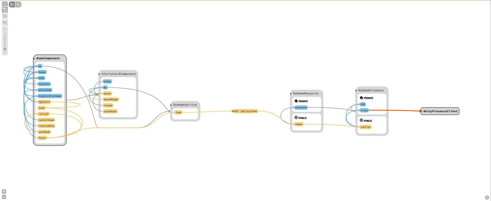

# Sourcetrail

Sourcetrail is a free and open-source cross-platform source explorer that helps you get productive on unfamiliar source code.

__Links__
* [Download](https://github.com/OpenSourceSourceTrail/Sourcetrail/releases)
* [Quick Start Guide](DOCUMENTATION.md#getting-started)
* [Documentation](DOCUMENTATION.md)
* [Changelog](CHANGELOG.md)



Sourcetrail is:
* free
* working offline
* operating on Windows, macOS and Linux
* supporting C, C++, Java and Python
* offering an SDK ([SourcetrailDB](https://github.com/CoatiSoftware/SourcetrailDB)) to write custom language extensions

## Using Sourcetrail

To set up Sourcetrail on your machine, you can either download the respective build for your operating system from our list of [Releases](https://github.com/OpenSourceSourceTrail/Sourcetrail/releases) and install it on your machine, or use one of the following package managers:
 > The following command will install the original Sourcetrail that is currently archived!

* Use the [Chocolatey package](https://chocolatey.org/packages/sourcetrail) with `choco install sourcetrail`

After your installation is complete, follow our [Quick Start Guide](DOCUMENTATION.md#getting-started) to get to know Sourcetrail.

## How to Contribute

* Please read and follow the steps in [CONTRIBUTING.md](CONTRIBUTING.md) file.
* If you are looking for more information about Sourcetrail software development, please refer to our [wiki](https://github.com/CoatiSoftware/Sourcetrail/wiki).

# How to Build

Building Sourcetrail requires several dependencies to be in place on your machine. However, our CMake based setup allows to disable indexing support for specific languages which reduces the number of dependencies to a minimum.

## Building the Base Application

### Required Tools

* __CMake v3.12 (required for Windows, Linux and MacOS)__
    * __Reason__: Used to generate a build configuration for your build system
    * __Download__: https://cmake.org/download

* __Git (required for Windows, Linux and MacOS)__
    * __Reason__: Used for version control and to automatically generate the Sourcetrail version number from commits and tags
    * __Download__: https://git-scm.com/download
    * __Remarks__: Make sure `git` is added to your `PATH` environment variable before running CMake

* __Visual Studio (required for Windows)__
    * __Reason__: Used for building Sourcetrail
    * __Download__: https://visualstudio.microsoft.com/downloads/

* __ccache (optional for Linux and MacOS)__
    * __Reason__: Used to speed up rebuilds if found in `PATH`
    * __Download__: https://ccache.dev/download.html

### Required dependencies

* __Boost 1.67__
    * __Reason__: Used for file system access and interprocess communication
    * __Prebuilt Download for Windows__: https://sourceforge.net/projects/boost/files/boost-binaries/
    * __Building for Unix__:
        ```bash
        sudo apt install libboost-all-dev
        ```

* __Qt 5.12.3__
    * __Reason__: Used for rendering the GUI and for starting additional (indexer) processes.
    * __Prebuilt Download__: http://download.qt.io/official_releases/qt/
    * __Building with Unix__:
      ```bash
        sudo apt install qt5-qmake libfmt-dev qtbase5-dev qtdeclarative5-dev qt5-image-formats-plugins libqt5svg5-dev
      ```

### Building

#### On Windows
* To set up your build environment run:
    ```bash
    git clone https://github.com/OpenSourceSourceTrail/Sourcetrail.git
    cd Sourcetrail
    mkdir -p build/win64
    cd build/win64
    cmake -G "Visual Studio 15 2017 Win64" -DBOOST_ROOT=<path/to/boost_1_67_0> -DQt5_DIR=<path/to/Qt/version/platform/compiler/lib/cmake/Qt5> ../..
    ```
    _Hint: If you are using the CMake GUI, we recommend that you activate advanced mode. Also you may be required to add some of the defines via the "Add Entry" button._

* After generating the build configuration, just open the Sourcetrail.sln file that was generated by CMake and build the Sourcetrail project.

#### On Unix

* To set up your build environment run (change Qt5 and Boost paths if necessary):
    ```bash
    cd Sourcetrail
    mkdir -p build/Release
    cd build/Release
    cmake -DCMAKE_BUILD_TYPE="Release" ../..
    ```
* Now start the build with:
    ```bash
    make Sourcetrail
    ```

### Running

* Run Sourcetrail from within the build directory. During execution Sourcetrail needs resources from `bin/app/data` and `bin/app/user`. CMake creates symlinks within the build directory that make these directories accessible.

> Gradle imports use the project's Gradle wrapper version by default. Set `GRADLE_VERSION` before launching Sourcetrail only if you need to override that version. Without a wrapper or an override, the Gradle Tooling API chooses its default distribution.

## Enable C/C++ Language Support

### Required dependencies

* __LLVM/Clang 11.0.0__
    * __Reason__: Used for running the preprocessor on the indexed source code, building and traversing an Abstract Syntax Tree and generating error messages.
    * __Building__: Make sure to check out the correct tag: `git checkout llvmorg-11.0.0`
    * __Building for Windows__: Follow [these steps](https://clang.llvm.org/get_started.html) to build the project. Run the cmake command exactly as described.
    * __Building for Unix__: Follow this [installation guide](http://clang.llvm.org/docs/LibASTMatchersTutorial.html) to build the project. Make sure to build with `-DLLVM_ENABLE_RTTI=ON`.

### Building

* Run CMake with these additional options:
    ```
    -DClang_DIR=<path/to/llvm_build>/lib/cmake/clang
    -DBUILD_CXX_LANGUAGE_PACKAGE=ON
    ```
* Build Sourcetrail as described [above](#building).

## Enable Java Language Support

### Required dependencies

* __JDK 17__
    * __Reason__: Used to build the Java indexer and make it callable from the C++ code via JNI.
    * __Remarks__: Make sure that `<jdk_root>/bin` is available in your `PATH` environment variable and that the `JAVA_HOME` environment variable is set:
        ```
        JAVA_HOME=<path/to/Java>/jdkx.x.x_xxx
        ```

* __Maven__
    * __REASON__: Used within Sourcetrail's automated tests.
    * __Remarks__:  Make sure `.../apache-maven-x.x.x/bin` is available in your `PATH` environment variable and that both `M2_HOME` and `MAVEN_HOME` environment variables are set:
        ```
        M2_HOME=.../apache-maven-x.x.x
        MAVEN_HOME=.../apache-maven-x.x.x
        ```

### Building

* Run CMake with these additional options:
    ```
    -DBUILD_JAVA_LANGUAGE_PACKAGE=ON
    ```
* Build Sourcetrail as described [above](#building).

## Enable Python Language Support

### Required Tools

* __7z (required for Windows)__
    * __REASON__: Used to extract the prebuilt SourcetrailPythonIndexer which is downloaded automatically during build execution.

### Building

* Run CMake with these additional options:
    ```
    -DBUILD_PYTHON_LANGUAGE_PACKAGE=ON
    ```
* Build Sourcetrail as described [above](#building).


## Creating the deployment Package

### Windows

#### Required Tools

* __Visual Studio (required for Windows)__
    * __Reason__: Used for building the Sourcetrail Windows installer.
    * __Remarks__: Make sure to install the `.Net desktop development` workload.
    * __Download__: https://visualstudio.microsoft.com/downloads/

* __Wix 3.11__
    * __Reason__: Used to build the `sourcetrail.msi` Windows installer.
    * __Remarks__: Make sure to add `<path/to>/WiX Toolset v3.11/bin` to your `PATH` environment variable.
    * __Download__: https://wixtoolset.org/releases/

* __Wix extension for Visual Studio__
    * __Reason__: Used to run Wix from the Visual Studio build environment.
    * __Download__: https://marketplace.visualstudio.com/items?itemName=WixToolset.WixToolsetVisualStudio2017Extension

* __JRE__
    * __Reason__: Used for indexing the java sample project that ships with the package.

* __WinRAR__
    * __Reason__: Used for creating the final zip files for the installer and the portable package.
    * __Remarks__: Make sure to add `<path/to>/WinRAR` to your `PATH` environment variable.

#### Building

* Run `./script/deploy_windows.sh` from your Developer Command Prompt for Visual Studio. The script which will generate a 64bit build and packages it into a portable `.zip` file and a Wix-based Windows installer, each.
* If you run into trouble with version tag, edit ```cmake/version.cmake```, add **--tags** to line ```COMMAND ${GIT_EXECUTABLE} describe --long --match "[0-9]*" HEAD``` and replace the line ```string(REGEX REPLACE "^[0-9]+\\.[0-9]+-([0-9]+).*" "\\1" VERSION_COMMIT "${GIT_VERSION_NUMBER}")``` with ```set(VERSION_COMMIT "0")```

### macOS

After building, run the `bundle_install.sh` script within the build directory which will create a `Sourcetrail.app` bundle and generate a `Sourcetrail_<version>.dmg` container.

### Linux

After building with the `fork_release` preset, run `./setup/Linux/createPackages.sh` from the main directory. It creates `Sourcetrail_Linux_64bit.tar.gz` in the main directory, with the Qt libraries and plugins of the Qt the build linked against bundled. Packaging needs `patchelf`, `file`, `objdump` and ImageMagick's `convert`, and `libxcb-cursor0` installed so it can be bundled. Build and package on Ubuntu 22.04 (as CI does): the script rejects binaries that need a newer glibc than 2.35.


# How to Run the Tests

## Agent-friendly command-line frontend

Build `Sourcetrail_cli` with the same CMake configuration as the application:

```bash
cmake --build build/Release --target Sourcetrail_cli -j 4
```

The executable is `build/Release/app/Sourcetrail_cli`. It requires the adjacent
`Sourcetrail`, `sourcetrail_indexer`, and application data payload produced by the
build. No display server, IDE plugin, MCP server, or HTTP service is required.

```bash
Sourcetrail_cli index /absolute/path/project.srctrlprj --full
Sourcetrail_cli status /absolute/path/project.srctrlprj
Sourcetrail_cli search /absolute/path/project.srctrlprj DashboardConfigurationProperties --limit 20
Sourcetrail_cli describe /absolute/path/project.srctrlprj 123
Sourcetrail_cli references /absolute/path/project.srctrlprj 123 --kind CALL
Sourcetrail_cli read-source /absolute/path/project.srctrlprj /indexed/path/File.java --start-line 1 --end-line 80
```

- Commands emit one JSON object on stdout (`ok`, `command`, `project`, `result`);
  failures emit `ok: false` and `error`, with a nonzero exit status. Help is text.
- `index` waits for completion. Omit `--full` to update changed files. It runs the
  application's existing headless indexing command, including Gradle dependency
  resolution, Lombok detection/delombok and generated-source selection. Indexing
  diagnostics go to stderr, not into the JSON. `--timeout` defaults to 600000 ms.
- Indexing uses the same Java preferences as the GUI. The configured Java path
  is the JVM library, not `bin/java`. Gradle uses the project's wrapper unless
  `GRADLE_VERSION` overrides it. A failed preparation, interruption, or an index
  containing parse errors returns a nonzero exit status.
- Queries use the GUI's `PersistentStorage` APIs with a read-only index connection;
  they do not create a bookmark database or automatically reindex. `status` reports
  the last completed index timestamp and error counts, not a claim that the working
  tree is current. Symbol IDs are strings and must be looked up again after reindexing.
- `describe` returns signatures, locations and a definition excerpt (up to 200 lines).
  Reference kinds include `CALL`, `USAGE`, `TYPE_USAGE`, `MEMBER`, `INHERITANCE`, and
  `OVERRIDE`. `--limit` bounds results/locations to 1..1000; search/reference responses
  indicate truncation. `read-source` accepts indexed paths and at most 1000 lines,
  preferring stored index content and explicitly marking any disk fallback.
- In a project that uses Lombok, every source file is indexed from its delombok copy
  under `sourcetrail_dependencies/.../delombok/<source set>/<root>/`, not just the
  generated members. Delombok rewrites the whole class (adds a header and generated members, removes
  Lombok imports and annotations), so line numbers from any result do not match the
  original source file. Read the returned delombok path with `read-source`, or find
  the code in the original file by its content rather than by line number.
- A shared project lock excludes CLI queries and GUI/CLI indexing during writes.
  A busy project or an unfinished temporary index produces an error instead of
  silently returning a potentially inconsistent result. Restart an already-running
  GUI after rebuilding so it uses the same locking implementation.

Query/storage tests and a real headless Gradle/Lombok integration smoke test:

```bash
cmake --build build/Release --target Sourcetrail_cli_test -j 4
ctest --test-dir build/Release -R cli.queries --output-on-failure
JAVA_HOME=/path/to/jdk-21 bash testing/cli/smoke.sh build/Release/app/Sourcetrail_cli
```

The smoke test requires Bash, `jq`, and access to Gradle/Maven distributions or
their caches. It copies its fixture and creates isolated preferences in a temporary
directory; it does not modify your projects or Java preferences.

## `st`: code navigation for agents

`st` answers "who calls this", "what implements that", "how does A reach B" from an
existing Sourcetrail index, as plain text lines that pipe into each other.

### For agents

| Question | Command |
|---|---|
| Who calls X? | `st callers OrderService.place --depth 2` |
| What does X call? | `st callees OrderService.place` |
| Implementations or overrides (and the reverse) | `st impls PaymentGateway`, `st impls PaymentGateway.charge`; `st supers CardGateway` |
| How does A reach B? | `st path OrderController.create OrderRepository.save` |
| What breaks if X changes? | `st impact OrderService.place --group file` |
| A stack-trace line: its method and callers | `st at OrderService.java:42 \| st callers --depth 3` |
| Members of a class or file; package or class dependencies | `st outline OrderService`, `st outline src/main/java/com/acme/shop/OrderService.java`; `st deps com.acme.shop.order` (`--in` for incoming) |
| Files in a git diff to symbols | `git diff --name-only \| st symbols-in` |
| What uses a library annotation or type (`@Scheduled`, `TaskScheduler`) | `st refs Scheduled`; a whole library package: `st impact org.springframework.scheduling --depth 1` |
| Narrow a result by annotation, kind or file | `... \| st filter --annotated Test`, `--kind method`, `--not --file '*Test*'` |
| Text, config, strings, log messages | grep, not `st`; quote globs for zsh: `grep -rn --include='*.java' 'text' .` |

Names are a short name (`OrderService.place`) or a key; parameters take simple type names: `'OrderService.place(Order, int)'`.
- **Trust the answer.** No `st: incomplete:` line on stderr means the answer is complete as far as the index goes: don't
  re-read source to confirm it. Only the [blind spots](#st-known-limits) need grep or reading: text, config, strings, Java records,
  Lombok `@Builder` setters of a field, JPA metamodel uses (`Order_.status`), calls through a field of an unresolved type.
- **Exit 1** means none. **Exit 2** (ambiguous): pick a key from the candidates on stderr and rerun.
  **Exit 3** (not found): check the name, the parameters (count and simple type names; stderr lists the overloads), and the
  project: `st` picks it from the current directory, `st find <name>` names it (`find: 0 (project shop)`), `--project` overrides.

Faster: `st serve --detach` once per session keeps the index loaded (opt-in; `st status` shows `server running`).
```bash
st at OrderService.java:42 | st callers --depth 4 | st filter --annotated Test            # stack trace -> callers -> tests
git diff --name-only | st symbols-in | st impact | st filter --not --file '*Test*'          # diff -> what it can break, tests left out
st impls PaymentGateway.charge | st callers | st filter --annotated RestController           # interface -> impls -> annotated callers
```

### Build and reference

Build it next to the other binaries and put it on your `PATH`:

```bash
cmake --build build/Release --target st Sourcetrail Sourcetrail_cli -j 4
ln -s "$PWD/build/Release/app/st" ~/.local/bin/st
```

It needs the adjacent `Sourcetrail`, `sourcetrail_indexer` and data payload, like `Sourcetrail_cli`.
Create the first index with `Sourcetrail_cli index /abs/project.srctrlprj --full`. After an upgrade, an index built by an
older version needs one `--full` reindex; until then `st` exits 4 with `index is empty or incompatible; reindex with --full`.

**Project discovery.** `st` looks for a `.srctrlprj` in the current directory and upward. Failing
that it consults the registry `~/.config/sourcetrail/st-projects.tsv` (source tree to project file).
Any run with `--project /abs/project.srctrlprj` registers that project for its source tree, so
afterwards `st` works from anywhere in the tree without the flag.

**Commands:** `find`, `status`, `refs`, `callers`, `callees`, `impls`, `supers`, `path`, `impact`, `deps`, `filter`,
`symbols-in`, `at`, `outline` (see `st --help`).
The symbol is a name or a full key (`pkg.Class.method(pkg.Arg)`); without one, `st` reads
keys from stdin, one per line or the first tab-separated column, so commands pipe.
Ambiguous names exit 2 and list the candidates; a bare class name that matches only the class and its own constructors resolves to the class. A parameter list matching no overload exits 3 and lists the overloads.

**Output.** One tab-separated line per result: `key`, `kind`, `path:line`, source line
(`--no-source` drops it). Paths are relative to the current directory when below it. The count (`callers: 9 (project shop)`, the project file's base name)
goes to stderr; a `+N more (--limit)` overflow line ends stdout. Calls through an
interface show as `method via pkg.Iface.method()`. With `--depth` above 1 (or 0) `callers` and `callees` append
`, depth <n>` to the kind (`method, depth 2`; `depth 0` is reached through override links alone, such as the implementation
`callees` reaches through an interface method; `--limit` keeps the lowest depths). `--limit` (default 50), `--depth`, `--kind` shape results.
`find` ranks exact, then suffix, then substring matches. External (library) symbols are hidden.

```bash
st find --kind class OrderService
st callers 'com.acme.OrderService.place(com.acme.Order)' --depth 3
st find --kind interface Repository | st impls | st callers --depth 3
st path com.acme.Controller.create com.acme.Repo.save
```

**More commands.**
- `at <file>:<line>`: the symbol defined on that line (fields, declarations), else the innermost enclosing scope. A bare file
  name (`OrderService.java:42`, as in a stack trace) is matched as a path suffix; two matches exit 2 and list both on stderr.
  An absolute path that does not exist here (a CI or container stack trace) matches the indexed files sharing the longest
  path suffix with it.
  Text after a second colon is ignored, so `grep -Hn` output pipes in (plain `grep -n` on a single file prints no path and
  exits 64). `symbols-in` takes paths, so pipe `grep -l` into it.
- `symbols-in <file>...`: symbols defined in the files, in line order (no packages, files or type parameters).
- `outline <class|file>...`: a class's direct members, or a file's symbols, with `visibility kind` (`public method`) and a
  `path:line-endLine` range. An argument naming an existing file is a file, anything else a symbol.
  Package-private members print `package method`; interface and annotation members print no access word.
  `outline <class>` lists nested types but not their members.
- `impact <symbol>`: what a change can break: users, subtypes and overrides, transitively. `--depth` (default 0, unlimited)
  counts every hop except override hops; a class stands for all its members, a package for every type and member in it and
  its sub-packages (by name prefix, as in `deps`); the input's own symbols are not listed. `--group file|package` prints one
  line per file or package. Overrides are followed up and down, but not down again after going up. Rows read
  `<kind>, depth <n>`: `depth 1` is a direct user, `depth 0` is reached through override links alone (such as an
  implementation of an input interface method). `--limit` keeps the lowest depths. stderr gets
  `impact: N symbols in F files, P packages (project <name>)`.
  `| st filter --not --file '*Test*'` leaves out tests (symbol rows only: `filter` exits 3 on `--group` rows).
- `deps <symbol>`: outgoing dependencies, one row per top-level type (`class, N links`), or per package for a package input
  (`package, N links`; sub-packages are included). `--in` gives incoming. Links inside the input, external targets and builtin types
  are not counted; for a member input, its whole top-level class counts as inside, so links to sibling members don't count.
- `filter`: keeps the stdin lines that pass, unchanged and in order: `--kind K`, `--package P` (keys under `P.`),
  `--annotated A` (the symbol or its enclosing type carries `@A`), `--file G` (wildcard; with a `/` it matches the path, else
  the file name), `--not` negates the combination. Passing lines print unchanged, identical lines once. A key that is unknown or
  ambiguous, or a row that is not a symbol (an `impact --group` line), is named once on stderr (`st: symbol not found: <key>`), its
  lines are dropped, and the exit is 3 even when other lines pass; otherwise 0 with output, 1 without.

`--edges call,usage,type-usage,override,inheritance,import,annotation` picks the links `path` and `impact` follow (an unknown
name exits 64). Defaults: `path` `call,usage,override`; `impact` `call,usage,type-usage,override,inheritance,annotation`.
`--package`, `--annotated`, `--file`, `--not`, `--in`, `--group` and `--edges` on another command exit 64, as does `--kind`
on `outline`, `symbols-in` and `at` (pipe into `st filter --kind` instead).

**Names.** Type parameters may be left out: `Result.failed` finds `Result<T>.failed<T>(...)`. `find` hides type-parameter
nodes unless `--kind` asks for them.

**Input rules.** `filter`, `impact` and `deps` take symbols as arguments or keys on stdin; `symbols-in` takes paths; `at`
takes `file:line`. With Lombok, give the original path and line: the file maps to its delombok copy and the line maps back
through the generated code; every line of a statement delombok joined onto one line maps to it. A line with no counterpart
gets the symbol of the nearest mapped lines above and below when both give the same one; otherwise st reports it on stderr
(`st: <file>:<line> has no counterpart in the indexed (delombok) file`) and skips it rather than guessing, like an input that is
not indexed; `at` exits 3 only when every input was skipped. If a piped command was cut off by `--limit`, stderr says `input truncated upstream`.

```bash
grep -Hn 'placeOrder' src/main/java/com/acme/*.java | st at | st impact --group package
st find --kind class Controller | st filter --annotated RestController | st deps
```

<a id="st-known-limits"></a>

**Known limits.** Java records are not indexed as types by the bundled Java indexer: record types, constructors and
components are missing from every answer, and calls made inside a record body are attributed to no symbol. Classes an
annotation processor generates during the build (JPA metamodel `Order_`, MapStruct `...MapperImpl`) are not indexed either.
Field reads and writes are not distinguished (both are `usage`).
A class two modules both declare (same package and name, e.g. a test helper) is one symbol listed at both files, with
one access level per member in `outline` (one copy's private field can show as public); a third
module resolves it to the first copy on the class path, so its calls to members only the other copy has are missing
(`st` warns, see below; module-aware resolution is a tracked follow-up).

**Incomplete answers.** When an answer of `callers`, `callees`, `refs`, `impls`, `supers`, `path`, `impact` or `deps` touches such
a gap, stderr ends with one line, `st: incomplete: N links to unresolved symbols, M index errors (see st status)` (a zero part is
left out); stdout and the exit code stay the same. No `st: incomplete:` line means the answer is complete as far as the index goes; there is no need to re-read the source to confirm it, except for what the index never holds and so cannot warn about: plain text, config and string uses (use grep), switch arms and other code inside Java records, the Lombok `@Builder` setter of a field, and calls through a field whose type is unresolved (see Known limits and the next paragraph). N counts the links the command followed from the symbols it walked whose
other end the index could not resolve: the indexer's `unsolved-symbol` placeholder, or a symbol without a definition whose
package is one the project defines types in, or declares below one (library symbols and implicit members such as default
constructors don't count). M counts the index errors that belong to a walked symbol or to the symbol enclosing a result row: an
error belongs to the innermost named method or type around it (anonymous and local classes are skipped), at class level to a
field declared on its line, and outside every scope (an import) to the file's top-level types. `st status` adds the index-wide
totals, `files_with_errors` and `unresolved_symbols`.
A further part, `K symbols declared in several modules` (listed first; `st status` has no total for it, so the line drops
the hint when it is the only part), counts the inputs and the symbols the walk went on from, or types enclosing one, that
more than one file declares (a class two modules both have): their callers may be bound to the other copy or missing. A
result row in such a class does not count. The check assumes Java: in C and C++ a declaration in a header and a
definition in a source file count as several files, so `st` on C/C++ indexes is untested and may warn wrongly.
The warning can stay silent where a gap is real: the Java indexer reports an unresolved type once, where it is declared (a
field of a generated type), so calls through that field vanish without an error in the calling method; and `refs` of an
entity field misses its JPA metamodel uses (`Order_.status`) without a warning. `refs` and `impact` of a field of a Lombok
`@Builder` class do not reach the builder setter of the same name (the builder has its own field), so builder calls that set
it are missing without a warning; query `<Type>.<Type>Builder.<field>` as well.

`symbol not found` on a Java record or one of its members means records aren't indexed.

**Exit codes.** 0 results, 1 empty, 2 ambiguous, 3 symbol not found, 4 no index,
5 index stale (with `--no-refresh`, or when a refresh failed) or project locked past `--wait`, 64 usage error, 70 internal error.

**Lombok.** Sourcetrail indexes delombok copies, so `st` maps those locations back to the original
file and line, mapping only lines whose text matches the original unambiguously. Unchanged copies map line for line; a
location in a statement delombok joined onto one line maps to the original line holding its column. Generated members and other lines without an
original line print the original path without a line, `src/.../Order.java (generated)`; if there is no original file, the
row keeps the delombok `path:line` and the kind column gets `(generated)`. `--no-generated` (every command except `path`) drops those rows.

**Auto-refresh.** Before each query `st` compares source (and Gradle build file) times with the last index
and incrementally re-indexes if they changed, printing `refreshed N files in X.Ys` on stderr. The
`<project>.srctrlst` marker beside the project file records the last refresh so edits made during one are not lost.
`--no-refresh` skips this and exits 5 when stale; `--wait <ms>` bounds the wait for the project lock (default 30000).
File times are compared below the second; only a file saved within about 20 ms before a refresh started is refreshed once
more.

**`st serve`.** Opt-in resident server for one project: it keeps the index loaded and answers `st` calls over a Unix socket
(in `$XDG_RUNTIME_DIR/st/`, else `/tmp/st-<uid>/`; a directory not private to you is refused), so a query costs
about 100-150 ms instead of 0.4-0.6 s on a large project.
- `st serve` runs in the foreground; `st serve --detach` starts it in the background (output in `<project dir>/.st-serve.log`);
  `st serve --stop` stops it. `st status` ends with `server<TAB>running` or `server<TAB>off`.
- While it runs it watches the sources and re-indexes in the background after edits (logs: `<project dir>/.st-refresh.log` and `.st-refresh.log.verbose`), so
  the next query does not wait for the indexer. `--no-watch` turns this off. Add both logs to `.gitignore`.
- It is never started automatically, and there is one server per project. A client that finds no usable server answers itself.
- `--no-server` (or `ST_NO_SERVER=1`) answers in the calling process even when a server runs.
- Answers are identical with or without the server, and freshness is still checked per query. The server uses its own
  environment (`HOME`, `JAVA_HOME`, ...); the client's is not forwarded.
- stderr notes: `st: server <is from another build | speaks another protocol version | serves another project>; answering without it`,
  `st: server did not answer; answering without it`, and `st: waited Xs for the background refresh` (a query that arrived
  while a refresh was running). Measurements: `docs/superpowers/specs/2026-11-02-st-serve-results.md`.

**Measured** (Nov 2, 2026, on a private 2k-file Spring/Gradle service with Lombok; `testing/benchmark`, `bench.py speed`):

| | Without a server | With `st serve` | Target |
|---|---|---|---|
| Startup, `st status` | 400 ms | 83 ms | under 200 ms |
| Query, median over the questions | 0.56 s | 0.14 s | under 1 s |
| Query, slowest (`st at … \| st callers --depth 3`) | 1.11 s | 0.60 s | under 1 s |
| First query right after a one-line edit (it refreshes) | 9.4 s | 8.4 s | under 5 s |

With the watcher running, a query made some seconds after an edit finds the index already refreshed (about 120 ms).
In the agent benchmark (`bench.py run`: 9 questions, 3 runs each, fresh headless agents, the same prompt with grep only
or with `st` and the CLAUDE.md snippet), both arms answered 27 of 27 correctly; with `st`, agents used 23% fewer tokens,
25% fewer tool calls and 12% less time per question (medians), and picked `st` unprompted on 18 of 21 structural questions.

Tests for `st`: `ctest --test-dir build/Release -R cli.st` for the unit tests, and an end-to-end smoke test
(isolated home, copied fixture, JDK 21):

```bash
JAVA_HOME=/path/to/jdk-21 bash testing/cli/st-smoke.sh build/Release/app/st
```

## Existing application test suite

The automated test suite of Sourcetrail is powered by [Catch2](https://github.com/catchorg/Catch2). To run the tests, simply execute the `Sourcetrail_test` binary. Before executing, please make sure to set the working directory to `./bin/test`.


# License

Sourcetrail is licensed under the [GNU General Public License Version 3](LICENSE.txt).

# Trademark

The "Sourcetrail" name is a trademark owned by Coati Software and is not included within the assets licensed under the GNU GPLv3.
