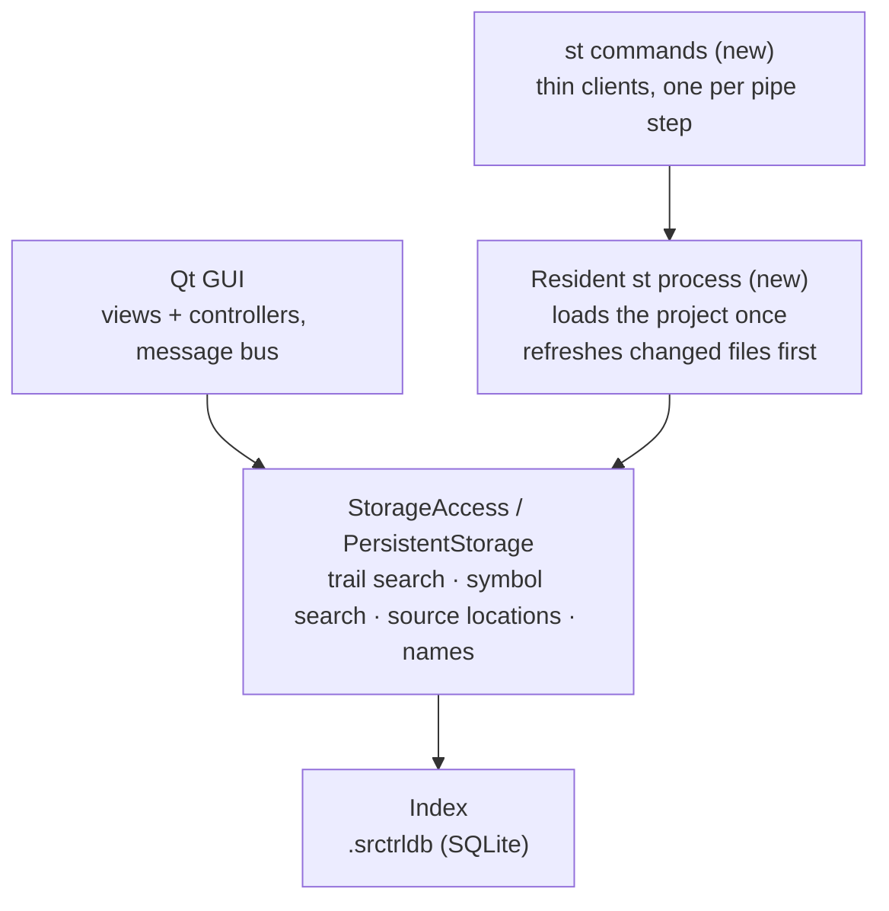

# Sourcetrail CLI — implementation notes

Oct 30, 2026 · Markus

Companion to the requirements doc: how the existing code can meet them. Ideas to borrow, not decisions.

## Approach

The CLI is another frontend on Sourcetrail's core, next to the Qt GUI. It reuses what the GUI already relies on (trail search, symbol search, source locations, changed-files indexing) instead of building it again.

It connects one layer below the GUI's controllers, at `StorageAccess` / `PersistentStorage`. The controllers run on an asynchronous message bus tied to their views. That suits an interactive window, but not a command that answers once and exits.

Only the thin `st` commands and the resident process are new. Everything they query is code the GUI already uses.

## Reuse map

One function, `getGraphForTrail`, covers most of the graph commands. Leave the origin out and it searches backwards (callers); leave the target out and it searches forwards (callees); give both and it finds paths. Everything below is on `StorageAccess`.

| CLI need | Existing function | Note |
| --- | --- | --- |
| `callers` / `impact` | `getGraphForTrail(0, X, …, depth)` | Backwards. Links: call, override and usage for `callers`; all types for `impact`. |
| `callees` | `getGraphForTrail(X, 0, …, depth)` | Forwards |
| `path` | `getGraphForTrail(A, B, …, depth)` | Returns every path's nodes and links. The CLI splits them into chains and sorts them. |
| `impls` / `supers` | `getGraphForTrail` with inheritance + override links | |
| `annotated` | `getGraphForTrail(0, annotation, annotation-usage links, 1)` | |
| `find` | `getAutocompletionMatches` | Fuzzy search the GUI's search box uses |
| `refs` | `getActiveTokenIdsForId` + `getSourceLocationsForTokenIds` | |
| `at file:line` | `getSourceLocationsForLinesInFile` + `getNodeIdsForLocationIds` | |
| `symbols-in` | `getSourceLocationsForFile` + `getNodeIdsForLocationIds` | |
| `outline` | `getGraphForChildrenOfNodeId` | Line ranges from scope locations |
| Readable names, signatures | `getNameHierarchyForNodeId`, `getTooltipInfoForTokenIds` | No hand-written decoder needed |
| Source line per result | `getFileContent` | Stored in the index, no disk read |
| `status` / `errors` | `getStorageStats`, `getErrorCount`, `getErrorsLimited` | |
| Refresh | The `index` command's changed-files mode | Same code path as the GUI's refresh |

## Startup cost

Opening a project calls `PersistentStorage::buildCaches()`. It walks every symbol in the index to build the search index, file path maps, member order and type hierarchy. If each pipeline step were a fresh process, each would pay that cost again. On a large project that probably blows the 200 ms startup target, but it needs measuring.

The proposal is one resident process per project:

- **It loads the project and builds the caches once.** Each `st` command is a thin client that sends a query and prints the answer.
- **It starts on the first command** and exits after a period of inactivity. Nobody manages it by hand.
- **It refreshes before answering when files have changed**, then rebuilds the caches. A command that reads its symbols from stdin skips the refresh, so only the first step of a pipeline triggers one.
- **A fallback for one-off use:** `--no-daemon` loads the project in-process and pays the startup cost.

Upstream's `sourcetrail_engine` is the same idea: a headless process with the project loaded, called over HTTP/JSON. Your fork would need its own, built on the old architecture.

## What the index holds

The index stores symbols of 21 kinds (class, interface, method, field, enum, annotation, file, package, …). Each has a definition flag: explicit, implicit, or none for external symbols. Every occurrence has a file, start and end line and column, and a location type (token, scope, signature, comment, unsolved). Visibility and full file contents are stored too.

| Link type | Meaning | Main use |
| --- | --- | --- |
| call | method → method it calls | `callers`, `callees`, `path` |
| usage | symbol → field or variable it uses; also Java method references | `refs`, `path` |
| type usage | symbol → type it mentions (field, parameter, return value, local variable) | `refs`, `impact`, `deps` |
| override | method → method it overrides | dispatch-aware `callers`, `path` |
| inheritance | type → supertype | `impls`, `supers`, `hierarchy` |
| member | class → its members | `outline`, expanding a class to its members |
| annotation usage | symbol → annotation on it | `annotated` |
| import / include | file → imported type or file | `deps` at file level |
| type argument, template specialization, macro usage | Generics, C++ templates, macros | filters |

**How the trail search behaves** (`PersistentStorage::getGraphForTrail`):

- **Breadth-first search** over the chosen link and symbol kinds. Depth 0 means unlimited.
- **Given both ends, it keeps every path that reaches the target,** not just the shortest. The CLI has to split the result into chains and sort them.
- **Override and inheritance links are followed from the overridden method to the methods that override it.** A forward search through an interface method therefore continues into its implementations.
- **Packages and namespaces are skipped as path nodes, and member links aren't drawn as path steps.**

## Index quirks to handle

Each quirk maps to a behaviour the requirements doc expects.

| Quirk | What the CLI does |
| --- | --- |
| Calls start from methods, never from classes | Expand a class argument to its members (member links) before searching, then roll the results back up to classes |
| A call through an interface lands on the interface method | Include override links by default in `callers`, `callees` and `path` |
| Java method references (`Foo::bar`) are stored as usage, not call | Include usage links by default, so `map(this::convert)` counts as a call |
| Field usage doesn't separate reads from writes | Not supported; the requirements list it as a known limit |
| Node ids can change after a full re-index | Pipes carry full name + signature. They're resolved back to node ids with `getNodeIdForNameHierarchy`. |
| Stored names use an internal tab-separated format | Always go through `NameHierarchy`; never decode by hand |

## Upstream MCP: borrow and avoid

[OpenSourceSourceTrail](https://github.com/OpenSourceSourceTrail/sourcetrail) (C/C++ only) has a basic MCP server in `mcp/sourcetrail_mcp.py`. It's about 390 lines of Python on top of their `sourcetrail_engine` HTTP/JSON API. Its four tools are `search_symbols`, `describe_symbol`, `find_references` (one step only) and `read_source`. It has no path search, no multi-level queries, no piping and no refresh.

**Borrow:**

- **Incoming and outgoing references, filtered by link type.** A clean model for `refs`, `callers` and `callees`.
- **The source line on every result.** Often saves reading the whole file.
- **A worked example in the README** (question → tool calls → answer). Agents pick up a tool faster from an example than from a parameter list.
- **Starting the engine lazily on the first call**, so listing tools stays fast.
- **An integration test registered in ctest.**

**Avoid:**

- **Its name decoder drops the signature**, so overloads collapse into one name. That would break our pipe key.
- **Symbol ids as the only handle between calls.** That's fine inside one engine session, but a pipeline that spans a refresh needs names.

## To verify against a real index

- [ ] How long `buildCaches()` takes on a large Java project. That decides whether the resident process is needed from day one.
- [ ] After a changed-files re-index, are callers in unchanged files still linked when a method's signature changes?
- [ ] Are calls inside lambdas attributed to the enclosing method?
- [ ] Does `getGraphForTrail` trace a Spring injected call (interface field, single implementation) end to end with call + override + usage links?
- [ ] Does a backwards trail (`callers`) climb from an implementation to calls made through its interface?
